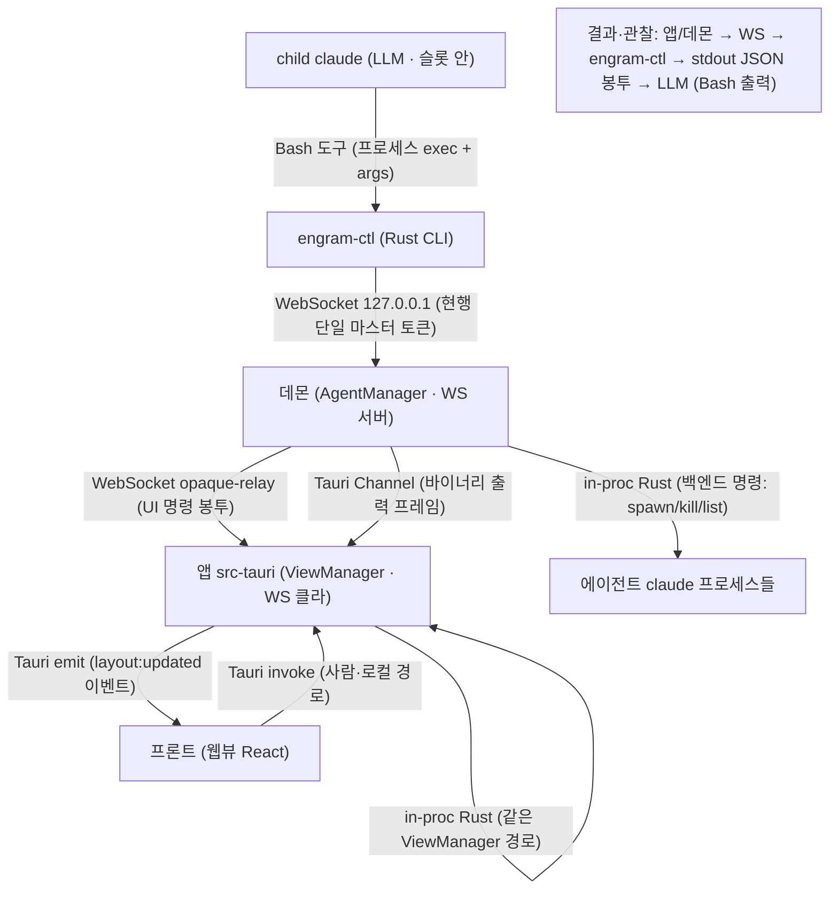

# PRD — LLM control surface (release-safe)

> Status: **requirements confirmed — passed `/review prd` full (2026-07-14, 2 blind adversarial reviewers, round 3).** Next = TRD. Architecture decision = ADR-0080.
> Contains only what/why (how = TRD). Rationale and rejected alternatives are recorded in ADRs.

## What / why

In a release build the LLM (a spawned child claude) cannot control the app — because the dev CDP and `window.__*` paths die in the release exe. This builds **the official control surface that realizes §5 (every feature is LLM-controllable) in release**.

**Full §5 coverage ≠ MVP completion (a measurable completion state).** §5 requires "every feature is LLM-controllable", but this is a multi-stage goal. The MVP does not achieve §5 *in full* — to prevent confusion the completion criterion is pinned down measurably: **MVP complete = the commands listed in the "MVP command catalog" below actually work in a release build from the LLM (child claude Bash).** Full §5 coverage is a later stage, and what is currently deferred (theme change, layout save/restore, tree navigation, render-mode override) is tracked as §5 gaps in `docs/tracking.md` T-11 (constraint layer), D-7 (layout persistence), etc. That is, passing the MVP does not claim to have "completed" §5.

**Scope/premise — MVP = a single client (app) instance.** The MVP presumes there is **exactly one app (client) instance** connected to the daemon. Targeting, which picks "which app is the target" among several app instances, is out of the MVP (deferred) — this premise removes the target ambiguity of UI commands from the MVP scope. Routing and identification across multiple app instances is later (see the broker routing open item). (Multiple agents (child claude processes) is normal — here "single" means the app instance that holds UI authority.)

## Background (problem)

- The current temporary path = `scripts/cdp.mjs eval` (a dev-only remote debugging port). The release `tauri.conf.json` has no such port, so it collapses.
- The control handles (`window.__engramLayout`, `__engramCmd`, `__ENGRAM_AGENT__`) are **inside the webview** → an external process (claude) cannot reach them.
- The spike `scripts/engram.mjs` (the ADR-0014 direction) already proved a release-safe path (daemon.json portfile → daemon WS → AgentCommand). But it is THROWAWAY (Node, unbundled, swallows errors, discards output).

## Requirements (behavior and policy language)

- **R1.** Works in a release build — independent of CDP/devtools.
- **R2.** A spawned child claude controls **with its own Bash tool** (without separate integration or user settings).
- **R3.** Controls **both** the backend (spawn/kill/list/preset) and the UI (split/tab/focus/move).
- **R4.** Commands are **semantic** (logical view-tree operations) — coordinates not exposed. A per-device **capability gate** (PC multi-window / mobile single window).
- **R5.** **Observation**: the command result + asynchronous state (output, liveness, list changes) can be confirmed through a finite set of primitives. + **A state-query primitive and stable addressing** — it must be possible to read the current view-tree and give a semantic relative target such as "put it in an empty slot". **Spatial vocabulary examples (addressing = direction/neighbor/order, no coordinates):** "to the right of the focused slot", "the first empty slot of view X", "the last slot of this tab". (The full vocabulary = ADR-0068 is the source of truth; here only minimal examples so that this can be judged.) **Two addressing modes (separate — do not mix them):** target designation splits into two modes, and staleness applies to only one of them.
  - **(a) ID designation:** the LLM passes on a **stable ID** it got from a read (`ViewId`, slot id, window label, etc.) as is → bound to that ID. If that ID has been **closed or has vanished** at execution time, it **fails with an explicit stale error code** — it never silently retargets to another target (prevents divergence between implementations). Staleness applies only to this mode.
  - **(b) live-relative designation:** a **live expression** such as "to the right of the currently focused slot" or "the last slot of this tab" is **resolved against the state at the moment of execution** (always relative to "now"). This mode has no notion of staleness — the LLM accepts that the target is "relative to the current focus, neighbors and order at execution time" and designates accordingly. Even if focus or neighbors changed between read and execute, that is not stale but a normal resolution against the latest state.

  The two modes are separate: an ID that was passed and has vanished (= stale, failure) and a live expression that resolved to a new current (= normal) are different events. The exact code and the nuance of telling the modes apart are open/TRD. (The MVP mostly satisfies this — see the "MVP command catalog" below.)
- **R6.** The result is an **honest structured response** (success/failure/whether retry is possible) — no false success. **A destructive or state-changing command is idempotent, or returns "already applied" as a distinguishable result** — so that a retry after a timeout is not silently applied twice (e.g. a duplicated split → the slot is split twice). This gives R6's "no false success" real effect (do not mistake sent for success, or a retry for new). **Retry identity (at-most-once):** a command is sent carrying a **client-assigned requestId**, and **a retry with the same requestId is deduplicated as at-most-once** — even if a non-idempotent command (spawn, write, etc.) is retried after a timeout, no second agent appears and the input is not delivered twice. This dedup must **survive reconnects within a session** (even if the connection drops and reattaches, the same requestId is not new). **Validity window = within the daemon lifetime (= one session).** The validity of the dedup is limited to while the daemon is alive — **a daemon restart resets the dedup state**, so a retry after a restart is best-effort (double application possible), and in that case the LLM confirms the actual effect with a read query and reconciles. The observable contract (WHAT) = at-most-once itself. The mechanism (dedup store, surviving reconnect, the exact retention window = memory vs durable) is TRD. The remaining robustness dimensions (atomicity of partial application, ordering/concurrency, version negotiation) are made concrete in the open items below.
- **R7.** ~~**Security**: a permission scope per child (get away from the all-or-nothing master token).~~ → **Deferred — out of the MVP, a risk accepted knowingly.** A single local PC = a single trust boundary, so the current full-power master token is allowed (fine-grained scope not started). **Accepted risk (explicit):** one prompt-injected child can use the shared master token to kill or write to sibling agents and operate the whole UI (child↔child lateral movement) — "single PC" covers only the external boundary and not an internally contaminated child. The deferral is kept knowing this (premise = local, trusted content; re-introduction = the mobile/remote daemon stage). Details and the user's re-confirmation = `docs/tracking.md` **T-11** (note of 2026-07-14). **Key consequence:** once R7 is deferred, nobody in the MVP does fine-grained authorization, so the contradiction "daemon opaque-relay (UI-semantics-ignorant) ↔ per-child scope" disappears — the opaque-relay stays clean. (This contradiction was the `/review prd` BLOCK, and the deferral resolved it.)

## MVP command catalog (scope — MVP/deferred boundary)

**Principle: the MVP exposes "only commands whose behavior already exists in the authority".** S17 builds no new backend/ViewManager operations — it builds only the release-safe *command path* (engram-ctl → daemon relay → ViewManager). Both of the following are already alive as dispatch / `#[tauri::command]`.

**The catalog = a closed set.** The MVP catalog is exactly equal to **all `AgentManager` wire commands currently dispatched + all `#[tauri::command]` of `ViewManager`** — that is, the set of operations already in the code is the catalog, and nothing is invented. The exact enumerated closed list is **extracted from the code and recorded in the TRD** (so completeness is verifiable rather than approximate — "nothing is missing" is confirmed by cross-checking against the code). The category grouping and file references below are left as they are for orientation.

**Composition of the MVP *surface* (A)+(B).** The "authority commands" above are part (A) of the catalog. The whole *surface* the MVP exposes = **(A) the authority commands above (exposed as they are)** + **(B) engram-ctl observation and discovery primitives** (`wait` · `events poll` · `output tail` · `list_commands`). (B) is not a new backend operation but **a thin CLI surface laid over the existing Subscribe/epoch/seq/replay protocol + capability data** (defined in R5/observation/AC). So the "closed set" includes both (A) and (B).

**Testability requirement (the whole catalog):** **every MVP catalog command has a result contract that includes boundary and error cases** — what it returns in failure and boundary situations, not only the success shape, must be defined for it to be verifiable by tests. Representative boundary examples: kill an agent that has already exited, close a non-empty slot, a profile reparent that would form a cycle (making your own descendant the parent), a command unsupported on the current device (outside the capability gate). The exact error codes and contract table per command are TRD.

- **Backend `AgentManager` (all wire commands currently dispatched, closed set):** spawn / kill / interrupt / write(stdin) / resize / list + **input lease** (acquire/release) + **profile CRUD** (create/delete/rename/reparent/auto-restore/spawn) + **preset CRUD** (create/delete/rename/list) + snapshot. (Definition: `crates/engram-dashboard-core/src/agent/manager.rs`, wire = `crates/engram-dashboard-daemon/src/connection_core.rs`. The exact enumeration = the TRD pins it from the code.)
- **UI `ViewManager` (all `#[tauri::command]` currently, closed set):** tabs (create/switch/close/rename), windows (create/close), slots (split/close/focus), content (assign_agent/set_slot_content), popout (move_slot_to_window), **and read queries** (get_view/list_tabs/list_windows/snapshot). (Definition: `src-tauri/src/layout/manager.rs`, commands = `src-tauri/src/commands/layout.rs`. The exact enumeration = the TRD pins it from the code.)

### Outside the MVP (§5 gaps — explicitly deferred)

Things that have a behavior (UI) but are **not attached to the authority (ViewManager/backend)**, so exposing them release-safe needs new wiring. The §5 gaps are stated explicitly rather than hidden:

- **Theme change** — explicitly declined by the user for v1.
- **Render-mode override** (forcing the renderer per slot).
- **Layout save/restore** — not implemented at present (see `docs/tracking.md` D-7).
- **Tree node navigation** — currently LLM read-only.

## Decided design direction

### Invocation

`claude Bash 도구 → Rust engram-ctl(protocol crate 공유·컴파일 산출) → 데몬 WS(토큰 auth)`. The model acts on the world only through text or tool-use, and here the **Bash tool = a structured action**.

- **MCP over HTTP excluded** — too much protocol ceremony for a local parent-child.
- **Local stdio MCP = outside the MVP, not forbidden** — revisit if the command catalog grows or "a narrow tool permission instead of a broad Bash" becomes important (cross-family review counterargument recorded).
- **chat-text parsing excluded** — fragile and hallucination-prone.

### Two authority domains + routing

- **Backend authority = the daemon** (`AgentManager`). `engram-ctl → 데몬 WS` directly. Portable to PC and mobile.
- **UI/layout authority = the app** (`ViewManager`, ADR-0035). **Daemon opaque-relay**: the daemon forwards the UI payload to the target app connection **without interpreting it** → the app applies it through **the same ViewManager path** as a local Tauri command → the result is retrieved by correlation. The daemon stays UI-ignorant (ADR-0035 preserved); only its role is extended to "an opaque broker between two clients (CLI↔app)".

### Command model (2 layers)

- **Domain layer (portable):** agent, preset — the same catalog on every device.
- **Presentation layer (device-specific):** layout — logical-tree semantic operations (no coordinates, ADR-0068 spatial vocabulary: neighbor, order, direction) + capability gate. `list_commands` returns the commands available on the current device (on-demand discovery).

### Observation

A shell command cannot hold a persistent stream across turns → finite primitives: `wait --until running|exited`, `events poll --cursor`, `output tail --agent --epoch --after-seq --until message-done`. On top of the existing Subscribe/epoch/seq/replay protocol.

**Turn-boundary contract (R5/observation — requirement):** the LLM must be able to **reliably detect the completion of a single response of a child agent (the turn boundary)**. `output tail --until message-done` must stop at the point where that child's one response ends — it must not cut off arbitrarily mid-response, nor swallow the next response and run on. **Response binding (which turn):** the tail **binds to one turn that starts at a known starting point (cursor/start point)** — so it selects **that clearly defined response**, not an arbitrary response after previously buffered output (it does not attach to "whichever done comes next" without a start cursor). **Observable result (WHAT):** the tail (a) if it reaches the turn boundary within the time limit, returns "done" + the output up to that point + a cursor to resume from, (b) if the time limit hits before the turn boundary, returns "incomplete (pending/timeout)" + the output so far + **a resumable cursor**, (c) if the cursor has expired or the daemon restarted, a "cannot resume (stale/reset)" signal, (d) **if the child is killed/exits or is interrupted during the tail, returns a terminal result** (aborted/exited) — it does not stay pending forever. **In no case silent truncation · no indefinite waiting** — the results must be distinguishable from each other, (b) must be resumable, and (d) must be terminal. The acceptance criterion (below) must actually prove "**it stopped at the turn boundary**", not "the tail returned something".

**State query (R5) = mostly satisfied by the existing ViewManager read queries.** `snapshot` (including the ADR-0068 direction-neighbor spatial metadata), `list_tabs`, `list_windows` and `get_view` are the view-tree state-query primitives. Stable IDs (`ViewId`, slot id, window label) already exist → a semantic relative designation such as "put it in an empty slot" is possible. **Two-mode addressing stance (same as R5):** (a) **ID designation** — passing a stable ID obtained by read binds to that ID, and if that ID has been closed or has vanished at execution time it fails with an explicit stale error (no silent reinterpretation or retargeting). (b) **live-relative designation** — an expression such as "to the right of the focused slot" is resolved live against the state at execution time and has no notion of staleness. The stale error applies only to (a) — see R5. The exact code and mode discrimination are in the open items below.

### Result contract

A stable JSON envelope — `{v,ok:true,requestId,result}` / `{v,ok:false,error{code,message,retryable}}`. A nonzero exit code. **UI success is confirmed only after the ViewManager applies it** (sent ≠ applied).

**UI command serialization (order serialization · observing the latest state):** UI commands are **applied sequentially by the single `ViewManager` authority (ADR-0035, in-proc)** — so success means **the ViewManager has finished applying**, not sending (sent ≠ applied is kept), and **the effect of a successful command is real at the moment it is applied**. A later read returns **the current state after that moment** — another actor (another child, a human) may have changed the state further in the meantime, so it does not guarantee that "a read always shows my effect as it is" (the single ViewManager serializes the *order*, but the *observation* is against the latest state). This is why concurrent UI operations are not a distributed race within the MVP scope: there is only one authority that applies in order (single app instance premise = "Scope/premise" above). So the relative order of two UI commands is decided by arrival order, and the result of each command reflects the state after that command was applied.

**write ⟂ input lease:** `write` (stdin) **presupposes holding the input lease** — writing without the lease (e.g. a human is typing in that slot or another holder exists) **fails with a distinguishable honest error code, not a silent no-op**. The existing `AcquireInput`/`ReleaseInput` lease (a Zellij-style single writer) is used as is. This makes stdin contention between human and LLM an observable, defined behavior (if someone holds it, write does not succeed and is explicitly rejected). **Automatic release when the holder is lost (preventing zombie locks):** a held input lease is **released automatically when the holder (connection) exits, disconnects or is killed** — a dead holder cannot block later writes indefinitely. (Current daemon behavior = the lease is auto-released on connection cleanup.)

### Deliverable

The Node spike (`engram.mjs`) → **a compiled Rust `engram-ctl`** (bundled, shares the protocol crate). Resolves the Node runtime dependency and being unbundled; lowers per-call spawn cost.

## Acceptance criteria

- **(Premise) discoverability (R2):** the Bash shell of child claude resolves and runs `engram-ctl` by name **without manual PATH setup** (no separate integration or user settings). A precondition of the spawn/kill/list AC below — if this does not work the commands do not run at all. (Mechanism = the spawn overlay, see open items.)
- In a release build the child claude succeeds at `engram-ctl spawn/kill/list` through Bash + retrieves the JSON result.
- While the app is running, `engram-ctl split/tab` → confirm reflection in `ViewManager` + result correlation.
- **Telling 3 routing failures apart (honest result codes):** the result of a UI command distinguishes the following three with different honest codes — (a) the app was not connected from the start = the command could not even reach the app (`APP_OFFLINE`, confirmed not applied), (b) the daemon accepted it but the app connection dropped before result correlation = whether it was applied is unknown (`APP_DISCONNECTED`/unknown, neither confirmed success nor failure), (c) timeout — the response deadline was exceeded, and **it may have been applied late** in the meantime (`TIMEOUT`, whether it was applied is unknown). The result must reveal that only (a) is "confirmed not applied" and (b)(c) are unknown states. **Reconciliation stance:** an unknown (b/c) state is reconciled by confirming the actual effect with a read query (snapshot, etc.) — the result code does not falsely claim "applied" (R6: no false success). The exact code set and the correlation/timeout reconciliation mechanism are TRD.
- With observation primitives, confirm spawn success and the output tail. **(Turn boundary)** Demonstrate that `output tail --until message-done` stops at the completion point of one response of the child — have it respond twice, and the first tail **stops at the first response boundary and returns done + a cursor** (does not swallow the second response), then retrieve the second response with that cursor. If the time limit hits before the boundary, confirm pending + a resume cursor (not silent truncation). It passes only by proving "it stopped at the boundary", not "it returned something".
- **State query (R5):** the `engram-ctl` read commands (get_view/list_tabs/list_windows/snapshot) return the current view-tree (stable IDs + ADR-0068 spatial metadata) as JSON → the LLM retrieves the basis for semantic relative designation ("empty slot").
- **Boundary and error contract (testability):** representative boundary cases return distinguishable honest results with no silent failure or false success — killing an already-exited agent (distinguish no-op/already-gone), closing a non-empty slot, rejecting a cyclic profile reparent, a command unsupported on the current device (rejected as outside the capability gate). Stale-ref addressing is an explicit error (no retargeting, R5 stance). The exact code per command = TRD.
- **Idempotency/duplication (R6):** a destructive command retried after a timeout is not applied twice — e.g. retrying a split of the same intent does not split the slot twice and returns an idempotent success or a distinguishable "already applied". **Retry identity (at-most-once):** retrying a spawn with the same requestId does not create a second agent and returns a single deduplicated result (at-most-once of a non-idempotent command, R6).
- **Multi-target non-blocking watching (events poll):** after spawning agent A, detect A's death and agent-list changes as cursor deltas with `events poll --cursor` **without blocking waits**. This is the path for supervising multiple agents in parallel — distinct from `wait`, which waits blockingly on a single target (avoids being tied to one target and unable to see other agents).
- **write→tail round trip (driving another claude conversation, end-to-end):** put a prompt to a child agent with `write` (stdin), then `output tail --until message-done` retrieves **exactly that one response** and stops at its boundary — this is the end-to-end demonstration of the loop "drive another claude by conversation" (after write succeeds on the premise of the lease, the tail binds to that response).
- **backend↔UI join (join key):** the backend `snapshot`/list (agent liveness and list) and the UI `snapshot` (slot↔agent mapping) share a **stable join key** (agentId ↔ the agent a slot references), so the LLM can answer "find the slot where a now-dead agent was and respawn there". Demonstrate that the two domains expose a stable key they can be joined on.
- **list_commands bootstrap (on-demand discovery):** the LLM's first-turn `list_commands` returns **the set of commands available on the current device** (on-demand discovery) — on a mobile-profile device the presentation-layer commands differ according to the capability gate (the domain commands are the same).
- (Mobile assumption) the domain commands are the same, the presentation commands differ by capability gate.

## Rejected alternatives (→ ADR-0080 rejected alternatives)

- **MCP over HTTP:** too much HTTP/JSON-RPC/handshake ceremony for a local parent-child.
- **chat-text parsing:** fragile, hallucination-prone, inferior to tool-use.
- **CDP-in-release:** the debugging port = a security exposure + WebView2 measurement unverified (the Chrome 136 basis does not apply to WebView2).
- **An app-owned separate endpoint for the UI:** a second endpoint, duplicated discovery and auth → higher cost than the daemon relay (on mobile the remote daemon is the only path, so the relay is also superior in portability).

## Open (to TRD)

- Control token injection: `profile.env` forbidden (agents.json plaintext) → an ephemeral spawn overlay (inherited handle). (Per-child scope itself is deferred as R7 = `docs/tracking.md` T-11 — the MVP uses the current single master token with full power.)
- **engram-ctl discoverability (R2):** the Bash shell of child claude must be able to resolve `engram-ctl` by name ("without user settings"). The direction = when spawning the child, the daemon injects the path of the bundled engram-ctl into that process's environment (PATH or a dedicated env var) — **the same spawn overlay hook** as the control token injection above. The exact form (PATH prepend vs env var) is TRD. (A purely internal mechanism — not perceptible to the user.)
- event journal (durable cursor) vs `ListAgents` reconciliation.
- The exposed form and discovery (`list_commands`) of the command catalog — the target operations are fixed by the "MVP command catalog" above; the vocabulary, arguments and gate representation are TRD.
- Daemon broker routing: app identity/lease, multiple windows (main+popout), offline policy, request→result timeout.
- **Stale-ref semantics (R5) — stance decided (R5 2 modes: ID designation = stale error, no retargeting / live-relative = resolved at execution time, no staleness), mechanism TRD:** the exact error code set, the implementation of live resolution (resolved against the state of which moment), the conditions of an automatic reinterpretation exception (if any) — TRD.
- **Retry identity (at-most-once) — stance decided (R6: a retry with the same requestId = not new, survives reconnects within a session, but validity window = within the daemon lifetime, reset on daemon restart), mechanism TRD:** the form of the dedup store, how it survives reconnect, the exact retention window (memory vs durable), requestId lifetime — TRD.
- **Ordering/concurrency — stance decided (result contract: the single ViewManager authority applies sequentially → order serialization; observation is against the latest state = not strict read-your-writes), mechanism TRD:** the form of the sequential-apply queue/lock, the point where the order of concurrently arriving commands is fixed — TRD.
- **R6 robustness — truly open (hard):** idempotency, retry identity and ordering have stances fixed above. The truly open hard dimensions left here = **atomicity of partial application of a multi-command intent** (atomicity on a mid-way failure when one logical intent is split across several commands), **mixed-version negotiation** (negotiation when the engram-ctl↔daemon↔app versions mismatch). — TRD.

## Message flow (by transport)

- **claude ↔ engram-ctl:** Bash tool (process exec) — tool-use.
- **engram-ctl ↔ daemon:** WebSocket (127.0.0.1, current single master token — per-child scope = T-11 deferred). Commands up · results and events down.
- **daemon → backend:** in-proc (AgentManager directly).
- **daemon → app (UI):** WebSocket opaque-relay (reuses the existing daemon↔app connection).
- **app (src-tauri) → ViewManager:** in-proc (the same path as a local Tauri command).
- **src-tauri ↔ frontend:** `emit` (events downstream) · `invoke` (human and local commands upstream).
- **daemon → app:** Tauri Channel (binary output frames).

## Links

- Basis: `docs/research/control-surface-and-fleet.md`, `command-control-surface-survey-2026-06-28.md`, `llm-control-surface-message-command-scope-2026-06-28.md`.
- Direction anchors: ADR-0014 (daemon CLI-via-Bash) · authority: ADR-0035 (layout = src-tauri) · spatial vocabulary: ADR-0068 · spike: `scripts/engram.mjs`.
- Next: ADR-0080 (control-surface architecture) + `/review prd` + TRD.
