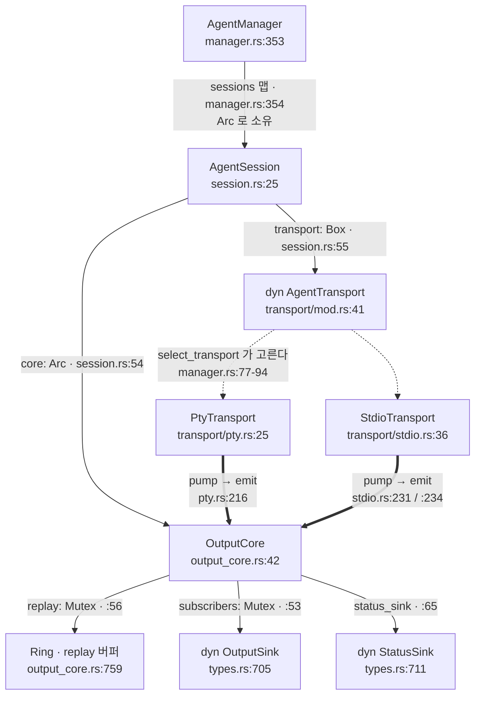
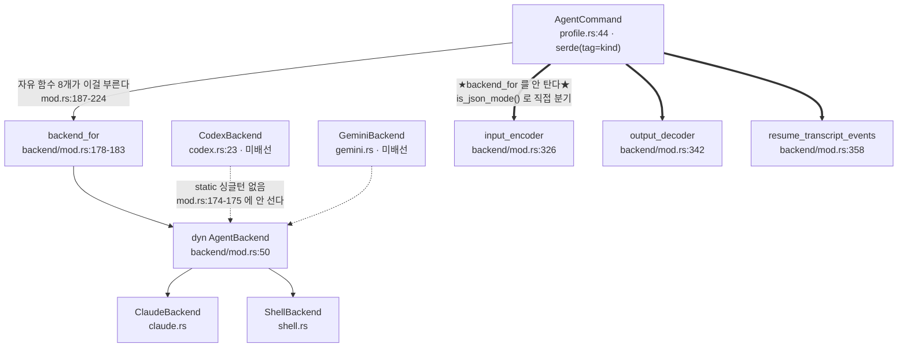
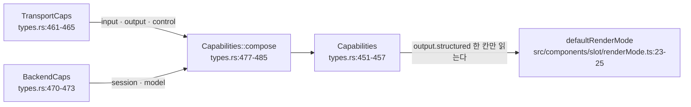
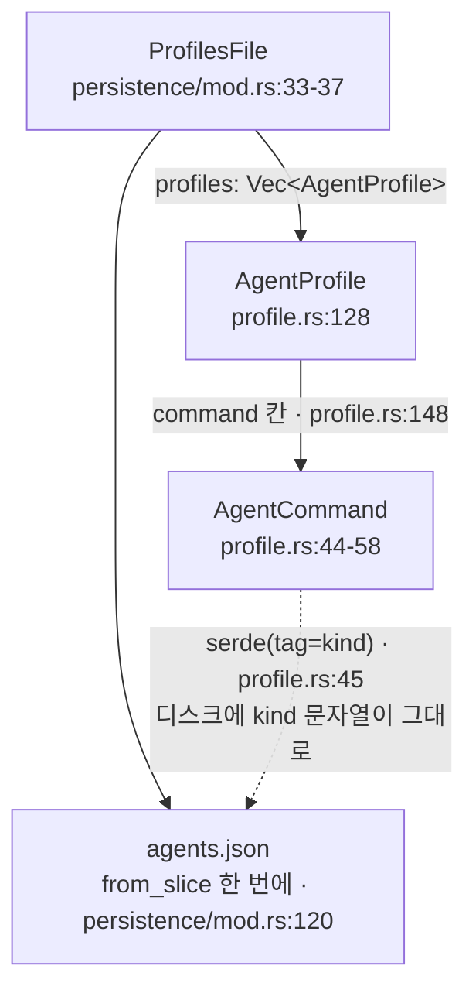
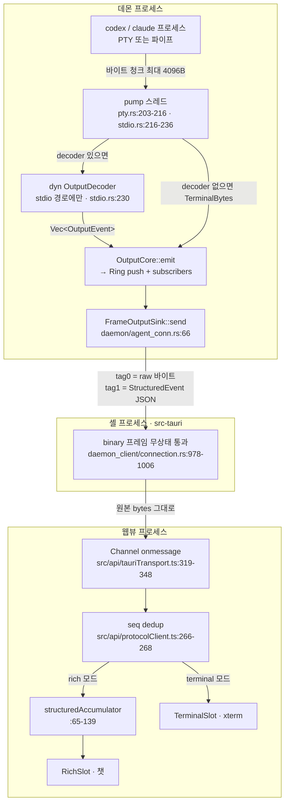
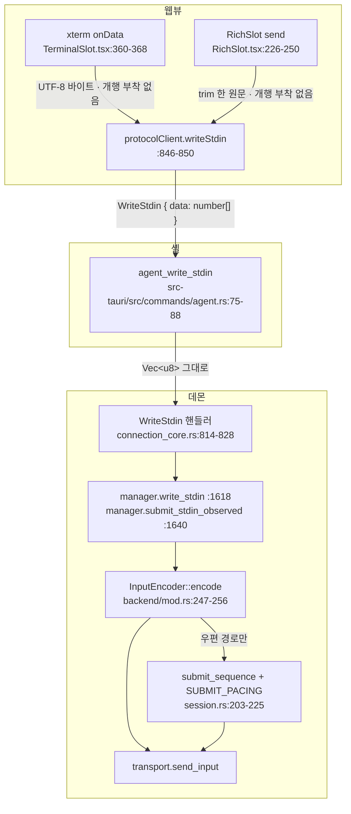
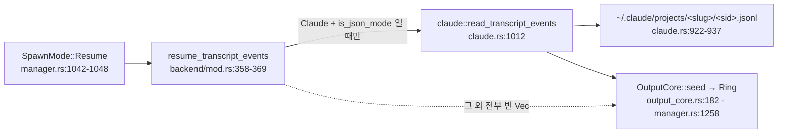

# TRD — codex backend Phase 0 · Phase 1 (S21)

> Status: **first edition (2026-09-07).** It covers only the **first two** of the three phases fixed by the approved design briefing (`briefing.html`). The backend contract test bench, which the briefing listed as an 「상시」 item, is **moved up to Phase 0 and stands before any wiring** (user decision 2026-09-07). Phase 1 wiring starts only after the facts we know today from `--help` text alone have been confirmed by actually running codex there.
>
> **How to read:** every claim in this document about codex behavior carries a **source grade**: `[실측]` (actually run on this PC) · `[도움말]` (only read in the `--help` text, never run) · `[미확인]` (neither). A codex claim without a grade must not appear in this document.
>
> **★Items waiting on a user decision are collected in §6, and this document picks none of them★**, following the order in CLAUDE.md 「개발 스텝」 (options → user decision → implementation).
>
> Anchors: **ADR-0004** (backend knowledge isolation, the basis of this whole work) · **ADR-0058** (spawn_into explicit backend fail-loud, ★Phase 1 must discard it, §4-6★) · ADR-0099 (channel capability tripwire) · ADR-0113 (turn signal classifier) · ADR-0044 (input encoding and output sanitizing) · ADR-0002/0030 (capability output) · ADR-0019 (reaper registration order) · ADR-0001 (kill causality) · ADR-0012 (module isolation and test harness) · ADR-0155 (command bus declaration) · CLAUDE.md 「백엔드 확장」·「핵심 불변식」·「LLM-우선 제어」 · `docs/reference/architecture-overview.md` 「세션 복원 / 활성화」 (the old CLAUDE.md 「세션 복원」 section was deleted by ADR-0186, and the source of truth is here).

---

## 0. Scope

### What this document decides

- **Phase 0** — Stand up the backend contract test bench and **actually launch** codex to confirm what we now know only from `--help`. The bench is not a script used once and thrown away. It is **a foundation that gains one line each time a backend is added**.
- **Phase 1** — Launch codex as a **PTY interactive TUI** and draw it on the existing xterm path. There are only four things to prove: **it spawns · it enters the registry · the wire field picks the backend · it is drawn on screen.**

### What this document does not decide (out of scope, do not reopen)

| Item | Goes to | Reason |
|---|---|---|
| Resident JSON server (`codex app-server`) · translator (decoder) | Phase 2 | Fixed by the briefing. Phase 1 has **zero lines of translator** |
| Session restore (`--resume`) | Phase 2 | Phase 1 cannot control the sid (§2 measured) → it does not report the capability at all |
| Receiving mail (agent-to-agent messaging) | Phase 2 | Phase 1 **ships with it turned off** (§4-3) |
| Taking back the claude schema interpretation that leaked into the frontend | Phase 3 | It is cleanup on the claude side, independent of codex |
| Process model choice (one per conversation) | Already fixed in the briefing | The current structure stays as it is |
| MCP injection · system prompt injection | After Phase 2 | A path exists (§2) but Phase 1 does not use the control channel |

### Files held by another session — do not touch

A transport refactor running in parallel owns the items below. **No Phase 0 or Phase 1 change goes in here.**

- `src-tauri/src/daemon_client/**`
- `crates/engram-dashboard-net/**`
- The members list of the workspace root `Cargo.toml`

The briefing draws the same boundary: 「1단계의 대부분은 저쪽 transport 작업과 파일이 하나도 안 겹친다. 접합부(wire 칸·데몬 스폰·프론트 스폰)만 겹친다」. The touch-points table in §5 stops at those three joints.

---

## 1. Phase layout — why the test bench comes first

```
Phase 0  터전 + 실측        시험대를 세우고 실 codex 를 띄워 도움말 근거 가정을 확정
   ↓     게이트: §3-5 의 「설계를 뒤집는 결과」가 안 나왔을 때만 통과
Phase 1  배선              variant · dispatch · wire 칸 · 프론트 · 트립와이어
   ↓
Phase 2  상주 서버 + 번역기 (범위 밖)
Phase 3  프론트 해석 회수   (범위 밖)
```

★**The value of putting Phase 0 first is not 「먼저 안다」 ("knowing first") but 「틀렸을 때 배선을 안 짓는다」 ("not building the wiring if we are wrong")**★. At least three Phase 1 decisions stand on `--help` text (§2, help grade), and if those three are wrong the very shape of the wiring changes. If the wiring is built first, the moment we measure those three becomes the GUI measurement, and any refutation found there has to undo what is already built.

★**The old codex stub is exactly the fossil of that failure**★. `crates/engram-dashboard-agent/src/backend/codex.rs` says 「CLI spike 완료 후 확정한다」 and **even has a test written with guessed values** (`codex_fresh_uses_session_flag_best_guess`, `codex.rs:143`). All three of those guesses turned out wrong today (table in §4-2). The test bench turns that spot into a **spot where guesses cannot get in**.

---

## 2. What we know about codex — by source grade

Target: **codex-cli 0.153.4 (it rose from 0.151.0 at measurement time through codex's own auto-update), this PC, authenticated.** The grades below stay valid throughout this document.

### `[실측]` — confirmed by actually running it

| # | Fact | Effect on Phase 1 |
|---|---|---|
| M1 | Feeding stdin through a pipe gives `Error: stdin is not a terminal`, exit 1 | **PTY is the only interactive path**, so there is no room to choose a transport |
| M2 | The caller cannot choose the session id. There is **no** `--session-id`-style flag | `needs_session()` = **false** (§4-2). The claude contract in 「세션 복원 / 활성화」 (`docs/reference/architecture-overview.md`), where we control the sid, does not hold for codex. That invariant was revised to be neutral about the issuing party by ADR-0185 |
| M3 | Resuming is a **subcommand + positional argument**, not a flag (`codex resume <id>` / `--last`) | The stub's `--resume <uuid>` assembly is wrong from the grammar up |
| M4 | On Windows, `codex` on PATH is the chain `codex.cmd → node → codex.exe`. The real binary sits under a **version-stamped `node_modules` vendor path** | It cannot be hardcoded. Skipping the shim needs separate discovery and a fallback (§4-10 · §6-H) |
| M5 | There is a way to attach MCP per call: the global TOML override `-c mcp_servers.<name>={...}`. There is **no** flag like `--mcp-config <file>` | Phase 1 does not use it. We only record that when Phase 2 uses it, the injection has a **different shape** from claude's |

### `[도움말]` — only read in `--help` text, the behavior never run

| # | What the help says | Why it is risky |
|---|---|---|
| H1 | The interactive call is a bare `codex`. Flags `-C/--cd <DIR>` · `-s/--sandbox <read-only\|workspace-write\|danger-full-access>` · `-a/--ask-for-approval <on-request\|never>` · `-m/--model <MODEL>` | A flag **existing** and it **taking effect as intended** inside the PTY we create are different claims |
| H2 | `--no-alt-screen` = "Disable alternate screen mode. Runs the TUI in inline mode, preserving terminal scrollback history" | The text does not tell us **what gets better** in our xterm (§4-11) |
| H3 | The interactive path has **no** `--skip-git-repo-check` (that flag appears only on the `exec` side) | The help does not say **what** the interactive mode does when cwd is not a git repo: refuse, warn, or just start is unknown |
| H4 | There is no CLI flag for system prompt injection. The mechanisms are the `AGENTS.md` project document convention and the `model_instructions_file` config key | A Phase 2 matter. Phase 1 does not touch it |

### `[미확인]` — cannot be given any grade

- **We have never launched codex interactively.** What the screen draws and how it behaves at our PTY size are all unknown.
- The statement that codex issues its own session id as a UUIDv7 is **based on documentation and secondary sources, not a value we observed.** It is harmless because Phase 1 does not use this value, but we do not write that "we confirmed" it.
- Whether writing the body plus CR twice (the `SUBMIT_PACING` contract) **is read as a submit** in the codex TUI composer. This contract was measured only on the claude TUI.
- Whether the codex composer takes a multi-line body **as one block or splits it per line** when it is entered whole. ★There is no bracketed-paste marker anywhere on our injection path★ (`rg "200~"` → 0 lines, measured 2026-09-07), so whatever codex reads the LF as, we give it no hint at all.

### Peer precedent

- **octoally** uses exactly `--no-alt-screen` to fix resize and reflow problems inside an embedded terminal. The weight of this as evidence is "a peer that hit the same problem picked this switch", not "it is better on our screen" (the discipline of 「참조 구현」 in ADR-0038: precedent instead of magic numbers, but the precedent too is confirmed by measurement).

---

## 2.5. Structure diagrams — types and ownership · code and data flow

> **Why this section is here:** the question table in §3 and every decision in §4 stand on the types below. Reading without a diagram means re-tracing "which field belongs to whom" through the code each time, and ★**that re-tracing has been wrong once already**★: the approved design briefing wrongly listed `output.structured` as a backend field (§4-8). This section pins that ownership boundary **with the type definition lines**.
>
> ★**Everything drawn here was confirmed in the code**★. What could not be confirmed is not drawn and is written as **unconfirmed**. Line numbers follow the same discipline as §5 (read 2026-09-07), and the coder re-reads around each anchor before going in.

### 2.5-1. Type and ownership diagram

#### (a) Data-flow spine — who holds what



**★Ownership split: that line of CLAUDE.md 「핵심 불변식」 moved into code lines★**

| Owner | What it holds | file:line |
|---|---|---|
| `AgentSession` | `id` · `cwd` · `epoch` · `cols` · `rows` | `session.rs:26-30` |
| (same place, not in the invariant sentence) | `intent` · `backend_caps` · `encoder` · `reads_messages` · `submit_pacing` · `sleeper` | `session.rs:32`·`:35`·`:38`·`:45`·`:50`·`:53` |
| `OutputCore` | `subscribers` · `replay`(Ring) · `seq` · `status` · `finalized` · `drain_handle` | `output_core.rs:53`·`:56`·`:48`·`:49`·`:50`·`:68` |
| (same place, not in the invariant sentence) | `diagnostics` · `status_sink` · `on_terminal` · `turn` (turn-observation wiring) | `output_core.rs:62`·`:65`·`:73`·`:77` |
| `PtyTransport` | `master` · `writer` · `child` · `shutdown` · `reader` · `job_handle` | `transport/pty.rs:28-35` |
| `StdioTransport` | `child` · `stdin` · `stdout` · `stderr` · `shutdown` · `structured` · `decoder` | `transport/stdio.rs:39-53` |

★**The one line of this table that Phase 1 must read**★: **`StdioTransport` is the only transport that holds a decoder field** (`stdio.rs:53`). `PtyTransport` **has no** such field (`pty.rs:25-36`). The consequence comes up again in §2.5-2 (c).

#### (b) Backend dispatch — ★what goes through the trait and what does not★



**The methods of the `AgentBackend` trait: required and defaulted**

| Method | Kind | Default | file:line |
|---|---|---|---|
| `needs_session()` | **required** | — | `mod.rs:52` |
| `supports_control_channel()` | **required** | — | `mod.rs:62` |
| `accepts_mcp_config()` | **required** | — | `mod.rs:81` |
| `build_spec(...)` | **required** | — | `mod.rs:88-96` |
| `capabilities(&command)` → `BackendCaps` | **required** | — | `mod.rs:106` |
| `turn_classifier()` | has a default | `no_turn_signals` (silence) | `mod.rs:121-123` · default function `:168-170` |
| `resume_failure_kind(evidence)` | has a default | `None` (unknown) | `mod.rs:140-142` |
| `reads_messages()` | has a default | ★**`true` (fail-open)**★ | `mod.rs:153-155` |

The trait is `pub`, but **the surface used from outside is 8 free functions**: `needs_session` (`:187`) · `supports_control_channel` (`:191`) · `accepts_mcp_config` (`:195`) · `build_command_spec` (`:199`) · `backend_caps` (`:210`) · `turn_classifier` (`:214`) · `resume_failure_kind` (`:218`) · `reads_messages` (`:222`). Each is a one-liner `backend_for(c).<메서드>()`.

★**But three functions that carry backend knowledge do not go through that dispatch**★. Without knowing this, you cannot find the place when designing Phase 2.

| Function | What it does | How it chooses | file:line |
|---|---|---|---|
| `input_encoder` | Picks the `InputEncoder` tag | **Checks `c.is_json_mode()` directly** | `mod.rs:326-332` |
| `output_decoder` | `Option<Box<dyn OutputDecoder>>` | **Checks `c.is_json_mode()` directly** → `ClaudeStreamDecoder` hardcoded | `mod.rs:342-348` |
| `resume_transcript_events` | Seeds the past conversation | `AgentCommand::Claude` + json mode match | `mod.rs:358-369` |

★**These three are not `AgentBackend` methods**★. So **implementing one more method on `CodexBackend` does not reach them.** To attach the codex translator (Phase 2) you must **fix the branches of these free functions**, not `impl AgentBackend`. The doc comment of `output_decoder` (`mod.rs:340-341`) already points at that spot: 「새 backend(codex 등)는 자기 decoder 를 여기 분기에 추가하면 된다」.

#### (c) Capability composition — ★ownership is pinned in the types★



| Area | Source | Where it is made |
|---|---|---|
| `input` · **`output`** · `control` | ★**transport**★ | `AgentTransport::capabilities()` — `transport/mod.rs:56`. The PTY implementation = `pty.rs:312-333` |
| `session` · `model` | ★**backend**★ | `AgentBackend::capabilities(&command)` — `mod.rs:106`. The claude implementation = `claude.rs:263-277`, shell = `shell.rs:62` |

**★Pinning the spot where the briefing was wrong, by line★**

- `BackendCaps` has **only two fields, `session` and `model`**, at `types.rs:470-473`. The doc right above it (`types.rs:467-468`) gives the reason: 「input/output/control 이 여기 없는 건 의도다 — backend 는 그걸 만들 수 없다(**소유권을 타입으로 강제**)」.
- `TransportCaps` has **only three fields, `input`, `output` and `control`**, at `types.rs:461-465`. The symmetric doc (`types.rs:459`): 「session/model 이 여기 없는 건 의도다」.
- `output.structured` is a **field of `OutputCaps`** (`types.rs:501`), and `OutputCaps` goes into `TransportCaps.output` (`types.rs:463`). ★So **a backend cannot report this value**★: `BackendCaps` has no `output` field at all, and the compiler blocks it.
- The composition point is **only one place**: `AgentSession::capabilities()` (`session.rs:257-259`) calls `Capabilities::compose(self.transport.capabilities(), self.backend_caps.clone())`. The doc says `compose` is 「유일한 정상 생성 경로」 (`types.rs:476`).

**So `structured` for codex (PTY) is automatically false:** `is_json_mode()` is false for codex (`profile.rs:61-69`, true only for `AgentCommand::Claude` + `StreamJson`) → `select_transport` picks `PtyTransport` (`manager.rs:84-92`) → `PtyTransport::capabilities()` **fixes** `structured: false` (`pty.rs:321`) → the frontend picks `'terminal'` (`renderMode.ts:23-25`). **This chain is the conclusion of §4-8, "zero lines of renderer code change".**

#### (d) `AgentCommand` and the disk · `OutputEvent` and the ring



Today `AgentCommand` has only two variants: `Claude { extra_args, output_format }` (`profile.rs:49-53`, `output_format` is `#[serde(default)]`) and `Shell { program, args }` (`:54-57`). The dotted line above is where the risk in §4-6 stands: **the `kind` string is written to disk, and the file is parsed whole by a single `serde_json::from_slice`** (`persistence/mod.rs:120`).

**`OutputEvent` — what actually stays in the ring** (`types.rs:37-69`)

| variant | Fields | file:line | Who makes it |
|---|---|---|---|
| `TerminalBytes(Vec<u8>)` | raw console bytes | `types.rs:39` | PTY pump (`pty.rs:216`) · the stdio pump without a decoder (`stdio.rs:234`) |
| `TextDelta` | `text`·`turn_id`·`message_id` | `types.rs:40-44` | decoder |
| `ToolCall` | `name`·`args_json`·`id`·`turn_id`·`message_id` | `types.rs:46-53` | decoder |
| `Usage` | `input_tokens`·`output_tokens`·`turn_id` | `types.rs:54-58` | decoder |
| `MessageDone` | `turn_id`·`message_id` | `types.rs:60-63` | decoder |
| `Error(String)` | error inside the stream (not an exit) | `types.rs:65` | decoder |
| `Structured { kind, json }` | ★per-backend escape hatch: **the core does not interpret the content**★ | `types.rs:66-68` | decoder · input echo (`mod.rs:279-282`) |

`Ring` (`output_core.rs:759-764`) holds `StoredOutput { seq, event, cost_bytes }` (`:707-712`) and has **two limits**: `max_bytes = 2MB` (`:771`) and `max_events = 4096` (`:774`), and **exceeding either one alone evicts from the front** (`:789-797`). `cost_bytes` is not the exact wire size but an **approximation** from the sum of payload string lengths (`estimate_cost_bytes`, `:721-745`), because the core cannot serialize (`:716-717`). ★**It is memory only**★: this type has no disk persistence path (`Ring` is a single `VecDeque`, `:760`). The latest one entry always stays even when it exceeds the limit (the `len() > 1` guard at `:789`).

#### (e) What the second backend adds · ★what it does not touch★

| What it adds | Where | Basis section |
|---|---|---|
| One `AgentCommand::Codex` variant | `profile.rs:44-58` | §4-1 |
| `static CODEX_BACKEND` + one `backend_for` arm | `backend/mod.rs:174-175` · `:178-183` | §4-2 |
| The values of `impl AgentBackend for CodexBackend` | `backend/codex.rs` | §4-2 table |
| Tripwire match arms and array length | `backend/mod.rs` tests · `commands.rs` | §4-4 |
| One wire selector field + a daemon conversion branch | `protocol/messages.rs:99` · `daemon/connection_core.rs:963-980` | §4-5 |

| ★What it does not touch★ | Why it is not touched | Basis |
|---|---|---|
| `AgentSession` · `OutputCore` · `Ring` | These types do not know the backend: not one field is backend knowledge | `session.rs:25-56` · `output_core.rs:42-78` |
| The `AgentTransport` trait and its two implementations | codex rides the PTY as it is (`[실측 M1]` PTY is the only path) | `transport/mod.rs:41-57` |
| `Capabilities` / `compose` / `TransportCaps` | A change here would break the ownership split: §4-8 forbids it explicitly | `types.rs:451-486` |
| The `OutputEvent` variant list | Phase 1 has zero lines of translator, so no new variant is needed | the out-of-scope table in §0 |
| The frontend render branch | The single `structured` field already works correctly | `renderMode.ts:23-25` · §4-8 |
| The `input_encoder` · `output_decoder` branches | `Raw` + `None` is enough for Phase 1 (terminal) | `mod.rs:326-348` · §4-2 |

★**The last row is Phase 2's bill**★: Phase 1 leaves those two alone **because terminal mode means it can**, not because codex stays out of those branches. The moment Phase 2 turns on the resident JSON server, both `output_decoder` (`mod.rs:342`) and `select_transport` (`manager.rs:77-94`) open up. The latter opens **because it discards the decoder on the PTY branch** (`manager.rs:89-91`).

---

### 2.5-2. Code and data flow diagrams

It crosses three processes: the **daemon** (owned by `AgentManager`) · the **shell** (`src-tauri`, the daemon client) · the **webview** (React). Each hop is labeled **[neutral]** (does not know the backend) or **[claude-only]** (claude knowledge lives here).

#### (a) One chunk of output — from the CLI process to the pixel



| # | Hop | Shape of the data at that point | Interprets it? | Grade |
|---|---|---|---|---|
| 1 | CLI process → pump `read` | A byte chunk of arbitrary size (ignores line and character boundaries) | No | **[neutral]** |
| 2 | decoder `decode(&[u8]) -> Vec<OutputEvent>` (`transport/mod.rs:35`) | One chunk **splits into N events**. An incomplete tail stays in an internal buffer and merges with the next chunk (`ClaudeStreamDecoder.buffer`, `claude.rs:594`) | ★**Yes: this is the only interpretation point**★ | **[claude-only]** — the only implementation today is `ClaudeStreamDecoder` (`claude.rs:586`) |
| 3 | pump → `core.emit` (`pty.rs:216` · `stdio.rs:231`/`:234`) | `OutputEvent`. When the decoder is `None`, `TerminalBytes` **passes straight through** | No | **[neutral]** |
| 4 | `emit` → `Ring` + subscribers | `StoredOutput { seq, event, cost_bytes }`. Seq assignment and the finalize recheck are here | No | **[neutral]** |
| 5 | `FrameOutputSink::send` (`agent_conn.rs:66-...`) | `Bytes` → tag0 terminal frame (`:74-76`), `Event` → after `output_event_to_wire`, JSON → tag1 (`:80-...`) | No — **1:1 mirror** (`connection_core.rs:504-553`; `Structured{kind,json}` is only a field copy at `:548-551`) | **[neutral]** |
| 6 | codec (`protocol/codec.rs:48-64`) | `[tag 1B][agent_id 16B][epoch 4B][seq 8B][payload]`. The payload is `&[u8]`: ★**schema-blind**★ | No | **[neutral]** |
| 7 | shell relay (`daemon_client/connection.rs:978-1006`) | **Reads only the header** (agent_id, epoch). What passes the epoch filter is sent **as the original bytes** with `send_to_windows(registry, &labels, &bytes)` (`:1002`) | No | **[neutral]** |
| 8 | webview receive (`tauriTransport.ts:319-348`) | `decodeOutputFrame` (`src/api/wsFrame.ts:25-48`) → the output branch of `InboundMessage`, `{ kind, tag, agentId, epoch, seq, bytes }` (`src/api/transport.ts:20`) | No | **[neutral]** |
| 9 | seq dedup (`protocolClient.ts:266-268`) | Drops it if `f.seq <= st.lastDeliveredSeq` (`SubState.lastDeliveredSeq`, `:94`). The flush-reordered part gets the same guard (`:388-390`) | No | **[neutral]** |
| 10a | terminal render | Writes the bytes to xterm as they are (`TerminalSlot.tsx`) | No | **[neutral]** |
| 10b | rich render — accumulator (`structuredAccumulator.ts:65-139`) | Folds `StructuredEvent` JSON into an array of `StructuredItem` (`:21-29`, `text｜tool｜usage｜error｜structured｜separator`) | ★**Partly yes**★ — only when `kind === 'user'`, `extractUserUuid` (`:174-187`) parses claude's `{"type":"text","uuid":…}`. Every other `kind` passes through as an opaque string (`:126`) | **[claude-only]** — the 「Phase 3 프론트에 샌 claude 스키마 해석 회수」 in §0 is exactly this row |
| 11 | renderer choice (`renderMode.ts:23-25` → `ViewLayoutRenderer.tsx:209-220`) | By the single field `capabilities.output.structured`: `'rich'` (RichSlot) / `'terminal'` (TerminalSlot) | No | **[neutral]** |

★**Phase 1 codex does not pass through 2 or 10b at all**★: it is a PTY, so the decoder is `None` (§2.5-1 (b)) and `structured: false` sends it to xterm. **So in the output direction, the number of claude-only hops codex bites into is zero.** This is the physical form of 「번역기 0줄」 ("zero lines of translator").

> **Note — one code comment is stale:** `agent_conn.rs:71-72` says 「구조화 이벤트 생산자(B3 decoder→pump 배선)는 아직 미배선이라 런타임엔 Bytes 만 흐른다」, but `stdio.rs:228-231` is that wiring. The decisions in this section followed the code.

#### (b) One chunk of input — the way back



| # | Hop | Shape of the data at that point | Wraps it? | Grade |
|---|---|---|---|---|
| 1 | frontend input | ★**Plain UTF-8 bytes only: the frontend wraps nothing and appends no newline**★. xterm already gives Enter as `\r` (`TerminalSlot.tsx:360-368`); RichSlot sends only the `trim()`med original text, and a comment states that prohibition explicitly (`RichSlot.tsx:227-228`) | No | **[neutral]** |
| 2 | `writeStdin` (`protocolClient.ts:846-850`) | `WriteStdin { agent_id, data: Array.from(bytes), request_id }`: the wire type is `Vec<u8>`/`number[]` (`protocol/messages.rs:43-49`) | No | **[neutral]** |
| 3 | shell `agent_write_stdin` (`src-tauri/src/commands/agent.rs:75-88`) | It only puts the `Vec<u8>` in an envelope and relays it to the daemon | No | **[neutral]** |
| 4 | daemon handler (`connection_core.rs:814-828`) | After checking the lease, `manager.write_stdin(agent_id, &data)` (`:821`) | No | **[neutral]** |
| 5 | `InputEncoder::encode` (`backend/mod.rs:247-256`) | `Raw` → `bytes.to_vec()`, **byte-identical** (`:249`) · `ClaudeStreamJson` → `wrap_user_turn` makes **one JSON line `{"type":"user",…}` + `\n`** (`claude.rs:508-540`, the terminator at `:537-539`) | ★**Wraps only here**★ | **[claude-only]** — the schema lives in `claude.rs` alone |
| 6 | input echo (`mod.rs:272-284`) | `Raw` is `None` (the PTY already echoes locally) · `ClaudeStreamJson` immediately `core.emit`s `Structured{kind:"user",…}` | — | **[claude-only]** |
| 7 | submit — **the path splits in two** | the table below | — | — |
| 8 | `transport.send_input(InputEvent::Raw(...))` | The bytes go to the PTY writer / pipe stdin as they are | No | **[neutral]** |

**★The two paths where submit (turn start) splits: confuse them and the codex tab becomes read-only★**

| Path | Verb that calls it | Writes the submit bytes? | Real caller |
|---|---|---|---|
| **A human types directly** | `write_input` → `write_input_observed` (`session.rs:142`·`:156`) | ★**Does not**★: it never calls `submit_sequence`, because the human presses Enter themselves (`mod.rs:299-301`) | daemon WriteStdin handler (`connection_core.rs:821`) |
| **Mail (agent-to-agent message) injection** | `submit_input_observed` (`session.rs:203-225`) | **Does**: write the body → sleep for `SUBMIT_PACING` (500ms, `mod.rs:324`) (`session.rs:208`) → write the submit bytes in a **separate write** (`:214`) | `messaging_host.rs:130` → `manager.submit_stdin_observed` (`manager.rs:1640`) |

The values of `submit_sequence` (`mod.rs:303-308`): **`Raw` → `b"\r"`** (terminal Enter = CR, `:305`) · **`ClaudeStreamJson` → `None`** (the terminator `\n` that `encode` appended is that protocol's submit, so adding CR would contaminate the payload, `:297-298`).

★**What Phase 0 Q4 measures is exactly the bottom row of this table**★: codex's `InputEncoder` is `Raw` in Phase 1, so submit = `\r` + a 500ms gap, and that contract was **measured only on the claude TUI** (the unconfirmed list in §2). Because Phase 1 turns mail off (§4-3), **Phase 1 codex never takes the bottom row at all**. The reason the §3-5 gate measures it in advance anyway is that if Q4 is no, Phase 2 needs one more variant of `InputEncoder`, and **the shape of the wiring changes**.

#### (c) Restore (resume) — ★where claude-only is thickest★



| Hop | Content | Grade |
|---|---|---|
| dispatch (`mod.rs:358-369`) | It reads only when `AgentCommand::Claude { .. } if c.is_json_mode()`. Anything else is an empty `Vec` (`:367`) | **[neutral]** — the branch itself is neutral |
| path assembly (`claude.rs:922-937`) | ★**We reproduce a directory rule that claude makes**★: slugify cwd by turning non-alphanumerics into `-` (`claude.rs:907-918`) to get `~/.claude/projects/<slug>/<sid>.jsonl` | ★**[claude-only]**★ |
| parsing (`claude.rs:1012`) | claude's `.jsonl` transcript format | ★**[claude-only]**★ |
| seed (`output_core.rs:182` · `manager.rs:1251-1258`) | Push into the ring. ★**It finishes before the sessions-map insert**★ (`manager.rs:1241-1250`, which blocks at the source the two windows of empty-ring replay and seq interleave) | **[neutral]** |

★**codex does not take this whole picture**★. Two reasons overlap: `[실측 M2]` the caller cannot choose the sid, and Phase 1 reports `session.resume = false` (§4-2). **Where and in what format codex's own transcript exists is unconfirmed** (§2), and when Phase 2 opens it, **one more piece of backend-only code appears for codex**, with the **same shape as the claude-only middle two rows of the table above**, inside `backend/codex.rs`.

---

## 3. Phase 0 — the backend contract test bench

### 3-1. Where it lives · its name · how to call it

**Proposed location:** `crates/engram-dashboard-agent/tests/backend_contract.rs`
**Proposed target name:** `backend_contract` (→ `cargo test -p engram-dashboard-agent --test backend_contract -- --test-threads=4 --ignored`)

Three reasons:

1. **The integration-test spot of the `agent` crate already uses that convention.** The suites that launch real child processes are gathered in that crate's `tests/` (`headless.rs`·`reaper.rs`·`transport_smoke.rs`·`session_smoke.rs`, all real shell spawns), and CLAUDE.md 「빌드·검증 명령」 has **already written down why that crate's line carries `-- --test-threads=4`** (real PTY = real child process). Making a new place would mean explaining that flag discipline again.
2. **This crate is the home of backend knowledge** (ADR-0004 · CLAUDE.md 「백엔드 확장」). If the test bench that measures what a backend promises lived in another crate, that crate would come to know the backend.
3. **One file = one question table.** When a third backend is added, **one row is added**, not one file (§3-3).

★It carries `-- --test-threads=4`★: it launches real `codex` (and, later, other CLIs), so it falls squarely under CLAUDE.md's decision rule ("a crate that launches real child processes"). **CI does not use this flag, and that is intended**: the exception entry in the same document is the source of truth and is not decided again here.

### 3-2. When the binary is missing — **skip by default, fail in the explicit lane**

**Decision: tie it with `#[ignore]` so it drops out of the default regression entirely and runs only when called.** A missing binary is a **fail** inside that `--ignored` lane (no silent skip).

The reason is that **the precedent is already broken**. Today the 6 tests that launch real claude drop out by themselves through a runtime guard (`skip_no_claude`, `crates/engram-dashboard-daemon/tests/control_send.rs:85-98`) rather than `#[ignore]`, and **that guard does not work on the CI runner.** A workflow comment records that failure directly (`.github/workflows/ci.yml:117-125`):

> 그 가드는 ① spawn 호출 성공 ② 5초 내 목록 등장 만 보는데, claude 부재 시에도 프로세스는 일단 떠서 목록에 잠깐 잡히고 곧 죽는다 → 가드 통과 후 "잠듦" 상태에서 단언이 깨진다.

So CI ends up maintaining a **`--skip` list with the 6 fn names pinned verbatim** (`.github/workflows/ci.yml:126-135`). ★**codex suffers that failure even more**★: on Windows `codex` is launched wrapped as `cmd.exe /c codex` (§4-10), so even without codex **`cmd.exe` always launches successfully.** "Did the spawn succeed" can never tell whether the binary exists.

**Therefore:**

- Every executing item of the bench gets `#[ignore = "실 codex 필요 — cargo test -p engram-dashboard-agent --test backend_contract -- --ignored"]`. It drops out of the default workspace regression and CI **structurally, not by choice**.
- Inside the `--ignored` lane, **a missing binary = failure**. Whoever called that lane said "I will measure", so it must not quietly return green (the exact recurrence prevention for the accident above).
- **Do not grow CI's `--skip` name list**: `#[ignore]` is the only form where the names need not be managed by hand. That list going stale is the open matter of the current 6 tests.
- ★But `#[ignore]` has a price★: the suite can evaporate whole and still be green (the `lib_unit` line in CLAUDE.md records the same trap). So **one non-ignore item that only confirms it compiles** stays in the same file: an item that walks the question table and, without running anything, only asserts **that the table is filled in** (the 「선언」 column of the §3-3 table). It launches no child process, so it runs as is in CI.

### 3-3. Shape — the same question table for every backend

The bench asks **the same set of questions** of every backend. When a backend is added, one column is added.

| # | Question | claude (existing) | codex (Phase 0 fills it in) | How it is decided |
|---|---|---|---|---|
| Q1 | Does it **launch** under a real PTY: does it get a window and emit a first byte | yes (measured) | ? | automatic |
| Q2 | Is it **alive** under a real PTY: does it not exit for N seconds after the first output | yes | ? | automatic |
| Q3 | What happens when fed through a pipe (non-TTY) | it launches (json mode) | it dies `[실측 M1]` — **reconfirm** | automatic |
| Q4 | Is **body write + gap + CR** read as a **submit** in the composer (the `SUBMIT_PACING` contract) | yes (measured 2026-08-17) | ? | automatic (indirect, see below) |
| Q5 | Does a **multi-line body** go in whole, or split per line and submit several times | not measured | ? | automatic (indirect) |
| Q6 | Does `--no-alt-screen` **differ at the byte level** in our PTY (alt-screen entry sequence present or not) | not applicable | ? | automatic |
| Q7 | Does `--no-alt-screen` **look better** in our xterm (resize, scrollback) | not applicable | ? | **human eye** (§3-4) |
| Q8 | What does it do when cwd is **not a git repo** | it just launches | ? `[도움말 H3]` | automatic |
| Q9 | Can we choose the session id | yes (`--session-id`) | no `[실측 M2]` — **reconfirm** | automatic (confirm the flag is absent) |
| Q10 | Kill causality: after `shutdown()`, does the process tree **really** disappear (including the shim chain) | yes | ? | automatic |
| — | **Declaration**: is this backend's capability table filled in | filled | must be filled | automatic (no execution, runs in CI) |

**What "indirect" means for Q4 and Q5:** we cannot see the composer's internal state. All we can see is **the bytes the PTY gives back**. So the decision stands like this: put in a short body that can serve as a marker, and if ① the text is echoed in the output **before** CR is sent and ② within a set time after CR **new output that is not that text** arrives (whether the start of a model response or a spinner), we treat it as submitted. ③ If the screen stays static after CR, we treat it as not submitted. For multiple lines (Q5), make the same observation **before sending CR**: if a response has already started with LF inside the body, that LF was read as a submit.

★**This decision gives a direction, not accuracy**★: the refutation of "submitted" (③) is trustworthy, and the positive (②) is shaken by timing. So the results of Q4 and Q5 are **checked once more in the human-eye step of §3-4.**

### 3-4. Automatic assertions · human eye — written separately

| What is asserted automatically | What is decided only by a human eye |
|---|---|
| The process launches (Q1), is alive (Q2) and dies (Q10) | **Whether the screen is drawn properly in our xterm**: whether frames do not break, whether reflow after resize is right (Q7) |
| It refuses on a non-TTY (Q3) | Whether scrollback is usable (the very property `--no-alt-screen` sells) |
| Whether the output bytes contain an alt-screen entry sequence (Q6) | Whether color, box characters and Unicode widths hold up in our font |
| Whether it launches/dies in a non-git cwd + the exit code (Q8) | Whether after submit the **response flows in a form a human can read** (the reconfirmation of Q4 and Q5) |
| `--session-id` is absent (Q9) | Whether the input cursor and composer are not clipped at our size (80×24 default) |

★**We do not write that the bench covers Q7**★: Q6 (are there alt-screen sequences in the bytes) can be measured, but "so is it better on our screen" cannot. Merging the two questions into one line would claim coverage that does not exist.

**Procedure of the human-eye step:** it follows the discipline of CLAUDE.md 「GUI 실측」 as is: do not launch the app directly from a shell, but through a launcher in `scripts/` or `scripts/launch-detached.ps1` (outside the process tree + output only to a file). The concrete procedure belongs to the `/qa` binding §full and is not repeated here. **Because the human-eye step of Phase 0 has no codex tab yet**, launch it temporarily with a `AgentCommand::Shell { program: "cmd.exe", args: ["/c", "codex", ...] }` profile and only look at the rendering. ★This workaround is limited to Phase 0 and is discarded once Phase 1 opens the official path★.

### 3-5. The gate — which results mean the Phase 1 design is wrong

If Phase 0 observes **even one** of the following, do not start the wiring and reopen the design.

| Observation | The Phase 1 decision that collapses | Why stop before wiring |
|---|---|---|
| **Q4 = no**: body + gap + CR is not submitted | Reusing `InputEncoder::Raw` + `SUBMIT_PACING` (§4-2) | If submit does not work, the codex tab is a **read-only screen**. Phase 1's success criterion "it attaches to the screen" becomes only half true, and since the submit mechanism then differs per backend, `InputEncoder` needs one more variant, and that is a decision that changes the shape of the wiring |
| **Q5 = it splits per line** | The premise that mail can be turned on later (§4-3) · the implicit premise that multi-line input just works | An envelope body is free LLM text, so multiple lines are normal. If each line submits, one envelope becomes **several turns**, and the mail to be turned on in Phase 2 cannot stand on that. A separate design that brings a bracketed-paste marker into the injection path must come first |
| **Q1 = no**: it does not launch in our PTY combination | All of Phase 1 | There is nothing more to say |
| **Q8 = it refuses**: it dies in a non-git cwd | The spawn path that passes `cwd` through as is (§4-4) · the arbitrary cwd of `spawn_into` | Our spawn entry accepts **any folder**. If codex refuses that, most spawns fail even with the wire field open. The cwd policy (a rejection notice / an automatic check / another flag) must be decided before the wiring |
| **Q10 = no**: a grandchild process is left behind the shim chain | The judgment of §4-10 that the 「핵심 불변식」 kill causality holds as is | A leftover process is not a regression but an **invariant violation**. The Job Object placement must be looked at again, and that is a transport matter, not wiring |

★**Q6 and Q7 (alt-screen) are not in this table**★: whichever way they come out, what splits is *one default value*, not the *shape* of Phase 1 (§4-11 · §6-F).

---

## 4. Phase 1 decisions — each with its basis

### 4-1. The `AgentCommand::Codex` variant

**Where it lives:** `crates/engram-dashboard-agent/src/profile.rs:44-58`. It stands third beside the two existing variants.

```
#[derive(Debug, Clone, PartialEq, Serialize, Deserialize)]
#[serde(tag = "kind")]
pub enum AgentCommand {
    Claude { extra_args, #[serde(default)] output_format },
    Shell  { program, args },
    Codex  { … }   ← 신설
}
```

**Serialized form:** it uses the `#[serde(tag = "kind")]` internally-tagged form as is. It must have the same shape as its two siblings so that `agents.json` remains one kind of file. It is written to disk as `{"kind":"Codex", …}`.

**Fields:** ★**this document does not decide: user decision §6-C.**★ There are three branches.

- (a) **Just `extra_args: Vec<String>`**: symmetric with the claude variant and the smallest right now. Every codex flag flows in as a user input string. The price: **safety-relevant values** like `--sandbox` and `--ask-for-approval` pass **without a type**.
- (b) **A few typed fields + `extra_args`**: for example `sandbox`, `approval`, `model` and `no_alt_screen` as enum/bool and the rest as strings. The price: it **freezes into types, now,** the flags of grade `[도움말 H1]`, so the contract is fixed before Phase 0 confirms their meaning.
- (c) **Start with (a) and add `#[serde(default)]` fields later**: `ClaudeOutputFormat` really came in that way (`profile.rs:47-48`, 「옛 프로필·기존 호출자는 Terminal로 흡수돼 동작 불변」). That **the on-disk backward compatibility cost is 0** when adding fields later has already been demonstrated in this repository.

★**Whichever is chosen, a place to turn on `--no-alt-screen` is needed**★ (§4-11): choosing (a) makes it a default of `extra_args`, and choosing (b) makes it a field. §6-C and §6-F must ask about this dependency together.

### 4-2. The `backend_for` dispatch + `CodexBackend`

**dispatch:** `crates/engram-dashboard-agent/src/backend/mod.rs:178-183`. Stand the static singleton `static CODEX_BACKEND: CodexBackend = CodexBackend;` next to `:174-175` and add one more match arm. **Do not add a wildcard**: the comment at `:177` already gives the reason, and the tripwire of §4-4 stands on it.

★**There are three pieces of backend knowledge that the trait does not carry, separately: §2.5-1 (b)**★. `input_encoder` (`mod.rs:326`) · `output_decoder` (`mod.rs:342`) · `resume_transcript_events` (`mod.rs:358`) **do not go through the `backend_for` dispatch** and look at `is_json_mode()` directly. So however many methods are filled in on `CodexBackend`, those three do not change. Phase 1 gets by on the defaults for all three (`Raw` · `None` · an empty `Vec`), but **the place that opens when Phase 2 turns on the translator is there.**

**What each trait method must return for Phase 1:**

| Method | Phase 1 value | Basis |
|---|---|---|
| `needs_session()` | **false** | `[실측 M2]` we cannot choose the sid. If true, the manager issues a sid and attaches a watcher (`manager.rs:1068-1072`), but that sid is a value codex does not use, so the tracker polls for a file it can never find |
| `supports_control_channel()` | **false** | Phase 1 does not consume the control channel. ★If this value is false, the manager **never calls** provision★ (`mod.rs:56-58`), so it never creates the regression where a config-write failure blocks a spawn that did not need MCP |
| `accepts_mcp_config()` | **false** | `[실측 M5]` codex supports MCP, but its injection shape is the global override `-c mcp_servers.<name>={…}`, a **different mechanism from claude's `--mcp-config <path>`**. This flag does not ask "can it use MCP" but "**can it be fed this mcp-config file**", and the answer is no. Phase 2 reopens it |
| `build_spec(...)` | `codex` + interactive arguments. **Delete all session-flag assembly** | `[실측 M2·M3]` neither `--session` nor `--resume <uuid>` exists |
| `capabilities(_)` | `session { resume: false, snapshot: false, cwd_env: true }` · `model { select: false, temperature: false, max_tokens: false }` | `resume: false` is **coincidentally the same as the stub but the reason changed**: from "not measured, so conservative" to "**the caller cannot choose the sid, so lossless restore does not hold**". The comment must be rewritten with that reason. `model.select` has `-m` from `[도움말 H1]`, but **Phase 1 does not expose that field**, so it is false (the field reports not an ability that exists but **the ability this spawn uses**) |
| `turn_classifier()` | not declared (default = `no_turn_signals`) | Terminal mode has no structured events, so there is no signal to emit. ★That the default is silence is intended★ (`mod.rs:116-118`) |
| `resume_failure_kind(_)` | not declared (default = `None`) | There is no resume path at all |
| `reads_messages()` | **false — explicit declaration** | §4-3 |

**★Which values of the stub have now turned out wrong★** (`crates/engram-dashboard-agent/src/backend/codex.rs`)

| Spot | What the stub says | Reality | Replacement |
|---|---|---|---|
| `:19-20` | 「바이너리명이 "codex"인지 확인 필요」 | `[실측]` "codex" is right | Remove the confirmation request in the comment and mark it as measured |
| `:26-30` `needs_session` | `true` — 「세션 개념이 있다고 가정」 | `[실측 M2]` the caller cannot choose the sid | **false** |
| `:61-69` build_spec session flags | `--session <uuid>` / `--resume <uuid>` | `[실측 M2·M3]` the former does not exist and the latter is a subcommand + positional argument | **Delete the whole assembly** |
| `:71-89` command match | Consumes the `AgentCommand::Claude` arm and passes shell arguments to codex in the `Shell` arm | A spot that imitated someone else's variant because it had none of its own | Keep only the `AgentCommand::Codex` arm and make the rest `unreachable!` (the form of `shell.rs:54-56` in ShellBackend) |
| `:92` `CommandSpec { program: CODEX_PROGRAM, … }` | Puts the program name in **raw** | ★It does not launch on Windows★: the `console_command` wrapping is missing (§4-10) | Run it through `console_command(CODEX_PROGRAM, args)` (`claude.rs:242` is that form) |
| `:143·:151` tests | `codex_fresh_uses_session_flag_best_guess` · `codex_resume_uses_resume_flag_best_guess` | They pin a grammar that does not exist | **Delete** |
| `:158` test | `needs_session_is_true` | The opposite | Flip it to `needs_session_is_false` |
| `:99-100` capabilities comment | 「CLI spike 전이라 실제 능력 미상 → 전부 false」 | The values are mostly right and **the reason is stale** | Rewrite the reason on measured grounds |

★`crates/engram-dashboard-agent/src/backend/gemini.rs` is also an unwired stub of the same shape★: this work does not touch it. We only record here that, since the tripwire of §4-4 counts **only wired variants**, gemini stays outside that net.

### 4-3. Mail is turned off in Phase 1

**What the problem is:** the default of `reads_messages()` is **true (fail-open)** (`backend/mod.rs:150-155`). And the default of turn observation is also **silence** (the `turn_classifier` default = `no_turn_signals`, `mod.rs:116-123`). Multiply the two: **a backend that has not declared turn signals is read as "not busy", and it gets recipient eligibility automatically.** So if nothing is done, **a letter is stabbed straight into a codex that is thinking.** The 「주의」 section of the briefing lists this first.

**How to turn it off:** `CodexBackend` **explicitly declares `reads_messages()` as false.**

**Precedent:** `ShellBackend` does exactly the same thing: `crates/engram-dashboard-agent/src/backend/shell.rs:31-36`. Its comment even records the decision criterion ("true for an agent that **reads and interprets** input, false for a channel that **executes** input. If no judgment can be made, leave it false and raise it to the user", the tripwire comment at `mod.rs:544-548`).

★**Write in the comment that the classification reason differs from shell's**★: shell is false **because input is executed as a command**, and codex is false **because turns cannot be observed, so the busy moments cannot be told apart.** Same value, different reason, and what Phase 2 opens is only the codex-side reason. If the reason is copy-pasted from shell, a Phase 2 session reads it as "this is not an execution channel, though?" and turns it on without grounds.

### 4-4. Tripwires — breaking the build on purpose

Adding one more variant makes the following collapse as **a compile error or an assertion failure**. That is the design: 「갱신이 컴파일로 강제되는 목록은 rot하지 않는다」 (`backend/mod.rs:378-380`).

| Spot | What breaks | What must be filled in |
|---|---|---|
| `backend/mod.rs:389-395` `expected_channel_matrix` | A match with no wildcard → **compile error** | `AgentCommand::Codex { .. } => (false, false)`: the two values of §4-2. ★This spot is not "a place to write values" but **a door that forces a visit** to the four checklist items of `:382-388`★ |
| `backend/mod.rs:399-409` the `variants` Vec for iteration | A list filled by hand: if it is not grown, **codex is never called even once** (a silent pass) | Add an `AgentCommand::Codex` sample |
| `backend/mod.rs:552` `BACKEND_VARIANTS = 2` | The value itself does not break, but `variant_slot` (`:554`) is a compile error → growing the slots to 3 makes the **array length of `mail_eligibility_samples` (`:569`) mismatch, a compile error again** | Make it `3`. And add one codex line to the sample array |
| `backend/mod.rs:561-566` `expected_reads_messages` | A match with no wildcard → **compile error** | `AgentCommand::Codex { .. } => false` (§4-3) |
| `backend/mod.rs:588-603` `mail_eligibility_is_consciously_declared_for_every_backend` | Even if all three above pass, not filling in the sample makes the `covered` assertion a **runtime failure** | One of the three gates always catches it: that is the design of this test (`:576-580`) |
| **`agent/src/commands.rs:1478-1485`** `declared_backend` | ★The fifth net, not in the briefing★: a **reverse** match that sweeps `AgentCommand`, so a **compile error**. The only place that catches 「코어가 늘었는데 선언이 좁은 채로 남는 것」 (`commands.rs:261-263`) | Whether to open the `Codex` arm as `Some(AgentBackend::Codex)` or close it as `None`: **§6-G user decision** |
| **`agent/src/commands.rs:1511-1531`** `new_accepts_the_claude_backend_and_refuses_the_rest` | **The string `"Codex"` is already pinned** in the rejection list (`:1523`). Widening the command-bus vocabulary makes this assertion a **runtime failure** | Hangs on the same §6-G decision |

★**The first five are 「값을 채우면 통과」 ("fill in the values and it passes"), but the last two are not**★: the last two force out the policy question of **whether the LLM control surface may create codex**. If Phase 1 decides not to open that surface, it passes with `None` + keeping the rejection list, but that conflicts with CLAUDE.md 「LLM-우선 제어」, "when making a new UI feature, make its LLM call path together". §6-G is that fork.

### 4-5. The wire field

**Today's path:** frontend `spawn_by_cwd` → `SpawnByCwd { cwd, request_id }` (`crates/engram-dashboard-protocol/src/messages.rs:99`) → the daemon **hardcodes claude·StreamJson** (`crates/engram-dashboard-daemon/src/connection_core.rs:963-973`). The wire has no field for choosing a backend.

**Proposal:** add to `SpawnByCwd` **one optional field with `#[serde(default)]`**.

**★Name, shape and default are the §6-B user decision★.** The fork:

- Shape: `Option<String>` (loose, since the frontend already sends strings) vs a dedicated wire enum (strict, since a typo is caught as `INVALID_ARGUMENT`, but the wire vocabulary grows each time a value is added).
- Default: should `None` keep meaning today's fixed target (claude·StreamJson) as is, or should the wire carry an explicit `Claude` and treat `None` separately?
- Name: among `backend` / `backend_kind` / `command`. ★It is better to avoid `command`★: in this repository that word already has three meanings (`protocol::AgentCommand` = wire command · `agent::AgentCommand` = execution command · command bus). `messages.rs:24` and `profile.rs:41-43` already warn about that collision.

> ★**The four paragraphs below were refuted (2026-09-08, two reviews).**★ The conclusion was reversed: **`PROTOCOL_VERSION` is raised from 3 to 4** (the source of truth = the reversed row of the §6-1 table + the v4 entry of `crates/engram-dashboard-protocol/src/lib.rs`). What was wrong is written right after the original text below. **The original text is not deleted**: this repository keeps decisions together with their reversals.

~~**★Do not raise `PROTOCOL_VERSION`★**: the basis is a precedent in the same repository.~~

- `CreateProfile.output_format` **did exactly this**: `#[serde(default)]` is attached at `crates/engram-dashboard-protocol/src/messages.rs:113-114`, and the comment right above at `:111-112` says 「이 필드 없는 옛 프론트/wire는 Terminal로 흡수(기존 동작 불변, **PROTOCOL_VERSION 유지**)」. The same pattern appears three more times in `domain.rs` (`AgentProfile.display_name` `:300` · `AgentProfile.parent_id` `:305-306` · `AgentSpawnCommand::Claude.output_format` `:174`).
- The bump rule is at `crates/engram-dashboard-protocol/src/lib.rs:47-59`: 「깨지는 변경(필드 의미 변경·제거)에서만 +1」. The current value is `3` at `:60`.
- ★**The very case that raised it to v3 draws the boundary exactly**★ (`lib.rs:55-59`): the reason for raising it then was adding a **new enum variant**. In an externally-tagged envelope, an old daemon **rejects** an unknown key. So **adding a variant to the envelope is a bump, and adding a `#[serde(default)]` field inside an existing variant is a keep.** We are the latter.

**★The price of a silent failure: stated explicitly★:** if a new client sends a codex specification to an **old daemon**, that daemon drops the field it does not know and **launches claude instead.** No error, no warning. This is the **direct price** of choosing not to raise the version, and the third item of the 「주의」 section of the briefing records it. ★Moreover that claude is **StreamJson**, so it is drawn by the rich renderer★: it differs from the requested codex terminal screen even in appearance, so the user does notice that "something else came up" (without knowing the cause).

**★Where the decision above went wrong (2026-09-08)★**: the boundary itself in the third item is right, but **we mistook which side we stand on.**

- This change **does not stop at** 「기존 변형 안에 `#[serde(default)]` 칸을 더한 것」 ("adding a serde-default field inside an existing variant"): it **added a `Codex` variant** to `AgentSpawnCommand` (`crates/engram-dashboard-protocol/src/domain.rs`). That enum is `#[serde(tag = "kind")]`, so an unknown `kind` is not a tolerated unknown field but a **deserialization failure.** So we are the **former** that the third item records as 「bump」.
- So the failure mode is bigger than the one-line 「대가」 ("price") above. On a **new daemon + old shell**, the failure unit of `ProfileList` is the whole response, so the old shell loses not one codex row but **the whole registry**.
- The silent claude substitution on an **old daemon + new shell** (the 「대가」 above) also remains, and that is **the very failure** that the decision for `AgentBackendKind` not to have a default was meant to prevent. That decision reaches only a daemon that knows that decision.
- **「출시 전이라 지켜 줄 상대가 없다」 ("it is before release, so there is no one to protect") does not hold on this axis**: by design the daemon outlives a shell rebuild (even if the shell is rebuilt, it attaches as is to the daemon that was left running). The two combinations are made routinely **during local development**, not after release.
- A bump makes both loud: auth's version check (`crates/engram-dashboard-net/src/ws.rs`) + discovery's version-mismatch rejection reject/restart a mismatched daemon instead of reusing it. The regression net already exists: discovery's `version_mismatch_live_daemon_errors_without_spawn`.

**Daemon-side conversion:** the branch at `connection_core.rs:963-980` reads that field and picks the `CoreSpawnCommand`. **The precedent is right below it**: the `CreateProfile` branch (`:1006-1028`) already hand-matches the wire enum → core enum conversion (`:1015-1018`). Write it in the same shape.

★**Do not miss that this branch puts the profile into the registry**★: an ad-hoc spawn also goes through `manager.spawn_agent` → `register_for_spawn` (`agent/src/manager.rs:875-899`) and is **saved to disk** by `profiles.upsert_preserving_hierarchy`. So **even launching codex just once** writes `{"kind":"Codex"}` into `agents.json`. This means the risk in §4-6 is not hypothetical but occurs right on the first spawn.

### 4-6. ★The biggest risk★ — `agents.json` forward and backward compatibility

**The exact failure mode (confirmed in code):**

1. `AgentCommand` is `#[serde(tag = "kind")]`, so the `kind` string is written to disk as it is (`agent/src/profile.rs:44-46`).
2. The whole file is parsed in **a single serde call**: `serde_json::from_slice::<ProfilesFile>(&bytes)` (`agent/src/persistence/mod.rs:120`). `ProfilesFile { schema_version, profiles: Vec<AgentProfile> }` (`:33-37`). There is **no per-entry fallback.**
3. When an old build meets a `kind` it does not know, it falls into the `Err` branch (`:130-133`), `preserve_corrupt` pushes the file aside as `agents.json.corrupt-<ts>` (`:86-94`), and it **boots with an empty registry.**
4. The next save overwrites that empty list: profiles, session ids and tree parents vanish whole (a warning with the same intent at `profile.rs:176-181`).

★A code comment **has already predicted** this failure★, `agent/src/commands.rs:45-49`:

> 넓히는 것은 「변형 하나 더」가 아니라 **디스크 호환을 깨는 이주**다 … 새 빌드가 새 kind를 쓴 프로필을 저장하고 나면 옛 빌드는 그 파일을 **한 덩이로** 파싱하다 실패해 `.corrupt`로 밀어내고 **빈 명부로 뜬다** — 그 빌드에서 에이전트가 전부 사라진다.

**★Yet no test pins that scenario★**: the workspace has 0 tests that reproduce `unknown variant` (measured). What exists is only broken JSON syntax (`corrupt_is_preserved_and_empty`, `persistence/mod.rs:232-247`) and a schema version mismatch (`version_mismatch_keeps_file`, `:249-263`). **Whichever approach is chosen, write that regression test with it.**

**★Three approaches: this document does not choose. §6-A user decision.★**

| # | Approach | What it gains | What it loses · the price |
|---|---|---|---|
| **A1** | **Tolerant per-profile parsing**: first receive the file as `Vec<serde_json::Value>` and deserialize each profile separately, skipping and logging only the failed entries | Even on a downgrade, **claude profiles survive**. Today's "all or nothing" is gone | (1) **Old builds do not have this logic**: the builds out there today still die whole. So it saves **only future downgrades**. (2) **The next save erases** the skipped entries: to avoid silent data loss it must go as far as "preserve unknown entries verbatim and write them back" to be a real fix, and that changes the file model. (3) Once parsing is tolerant, **a typo also passes silently** |
| **A2** | **`SCHEMA_VERSION` bump** (`persistence/mod.rs:21`, currently `1` → `2`) | The old build falls not into the **`.corrupt` path but the version-mismatch path**: `:121-129` **preserves the file** and returns only an empty list. That **the file is not erased** is the decisive difference from A1 | (1) The old build still **boots with an empty registry** (it cannot read the claude profiles either). (2) ★And the next save may overwrite that preserved file★: what 「보존」 ("preserve") actually guarantees must be re-confirmed in the code. Choosing this option without confirming is no better than A1. (3) Even users who never use the new kind get a broken downgrade |
| **A3** | **Accept the downgrade loss**: do nothing, and leave only **a warning and a regression test** | No more code. It is the fastest wiring today | If a user who has **launched codex even once** goes back to an old build, **the registry empties** (the last item of §4-5: it is written right on the first spawn). It is a gamble that depends entirely on how often anyone goes back, and we do not know that frequency |

★**The three options are not mutually exclusive**★: A2 + A3 (raise the version to protect only the file and accept the loss) or an A1 + A2 combination is possible. And **no combination saves "the old builds already out there"**: the only way to save them is to write the codex profile in **a shape the old build can read** (for example disguised as `kind:"Shell"`), but that is a disguise, so the dispatch of §4-2 cannot read it back as codex. **Record it as a rejected alternative and do not bring it up again.**

### 4-7. `spawn_into`'s fail-loud rejection — ADR-0058 goes stale

**Today:** `src-tauri/src/layout/apply.rs:459-468` **rejects every explicitly given backend value before spawning**. It rejects even `"claude"`. The basis is the comment at `:439-447`: 「요청이 데몬까지 흐르지 않으므로 승낙은 지킬 수 없는 약속」.

**★That basis stops being true the moment §4-5 opens the field.★** Since the request flows to the daemon, the rejection becomes a refusal of a promise that can be kept.

**Action needed:** **a new ADR that discards (supersedes) ADR-0058 is needed.** ★This document does not write that ADR★: the user supplies the rejected alternatives and the basis, and the `/adr` skill does the numbering, the index and the discard stamp (CLAUDE.md 「설계 결정 기록」). The discard stamp is set **in the body of ADR-0058** (same section; if it is a one-way note only in the new ADR, a session reading only the old ADR follows a dead decision).

**New behavior (a proposal; the new ADR settles it):** the pre-spawn gate is **not removed but changes its meaning.**

- A known value (`claude` · `codex`) → passes. It is sent on to the daemon.
- Unspecified → passes. The daemon's default (today claude·StreamJson).
- **An unknown value → still a fail-loud rejection.** ★Why the rejection is not withdrawn whole★: a typo (`codx`) silently launching claude is an accident of the same shape as the old defect. The property ADR-0058 meant to protect ("the caller does not silently receive a different agent from the one it wanted") is **alive**, and what is discarded is only the *means* of protecting it (rejecting everything).
- ★**But this shell-side allowlist may diverge from the daemon vocabulary**★: if an old daemon does not know a value the shell let through, the silent claude of §4-5 happens as is. State in a comment that the shell's pass decision is **a typo net, not a promise**.

### 4-8. The renderer — ★where the briefing and the instruction sheet disagree with the code★

**What the instruction sheet said:** 「`capabilities().output.structured`를 false로 두면 렌더러가 terminal을 고른다」.

**★The code is not like that.★** `AgentBackend::capabilities()` returns `BackendCaps`, and that type has **only two areas, `session` and `model`** (`agent/src/types.rs:470-473`). `output.structured` is a **field of `TransportCaps`** (`OutputCaps.structured` = `types.rs:501`, comment `:498-500`: 「프론트 `defaultRenderMode`가 이 값 하나로 렌더러를 가른다」; `OutputCaps` is carried in `TransportCaps.output`, `:463`). The final `Capabilities` is merged by `compose(transport_caps, backend_caps)` (`types.rs:477-485`, the only composition point = `session.rs:257-259`).

★**The full picture of the ownership boundary is §2.5-1 (c)**★: it also quotes the spot where the doc comments of the two types say 「소유권을 타입으로 강제」 (`types.rs:459`·`:467-468`).

**So what actually happens: it comes out right even if we do nothing:**

```
profile.command.is_json_mode()          profile.rs:61-69 — Claude+StreamJson 일 때만 true
   → codex 는 false
select_transport(json_mode=false, …)    manager.rs:1229-1230
   → PtyTransport
PtyTransport::capabilities()             transport/pty.rs:321 — structured: false 고정
   → compose → capabilities.output.structured = false
defaultRenderMode(agent)                 src/components/slot/renderMode.ts:23-25
   → 'terminal' (xterm)
```

**Conclusion: the code change needed for renderer selection is 0 lines.** Since codex is not json mode, it rides the PTY, the PTY reports `structured: false` as a fixed value, and the frontend picks xterm from that single field.

★**Why this mismatch is recorded**★: following the instruction sheet's sentence as is would lead to adding an `output` area to `BackendCaps`, and that is a **change that breaks the transport/backend ownership split** (the compose comment in `types.rs` and 「type split 유지 — output/control은 여전히 transport 소관」 at `mod.rs:98-105`). We do not do it.

### 4-9. The frontend

**The `spawn_into` side is already open.** `agent.spawnInto` at `src/commands/tabCommands.ts:195-217` **already takes the `backend` argument and passes it through as is** (`:208`, `:213`). There is nothing new to build in the frontend: the spot where that value dies today is the Rust-side gate (§4-7).

**The `SpawnByCwd` side has no field.** `spawnAgent(cwd)` at `src/api/protocolClient.ts:835-837` builds the envelope. Once the field of §4-5 stands, one optional argument is added here. The interface declaration is at `src/api/agentClient.ts:178`.

**Banner: 「표시 전용, 렌더 분기를 몰지 않는다」:**

- **Today there is no way to tell the backend kind on screen.** `AgentInfo` has no such field (`src/api/types.ts:63-80`: only `id/name/cwd/status/cols/rows/epoch/capabilities`). The backend kind exists only in the `AgentCommand` mirror (`types.ts:102-104`), and that is a **spawn request type**, not runtime state. The `kind` in `AgentList.tsx` is `'running' | 'reserved'`, a **completely different axis**.
- So to build a banner, **a field must be added to `AgentInfo`, and that is a wire change.** ★Whether to open that field is the §6-E user decision★: the banner is not among Phase 1's four success criteria ("spawn · registry · wire field · render").
- If it is decided to open it, **the briefing already nailed down the discipline**: that value is **display only** and does not drive a render branch. The render branch is just the single `capabilities.output.structured` field of §4-8 and it is not touched. ★Here is what a violation looks like★: if even one line starting with `if (agent.backendKind === 'codex')` appears in the frontend, that is a violation. In the briefing's words, 「화면은 "codex"라는 낱말을 평생 못 본다」.

**LLM control path:** CLAUDE.md 「LLM-우선 제어」's "when making a new UI feature, make its LLM call path together" is **already satisfied**: `agent.spawnInto` is that surface and already takes the `backend` argument. **Do not make a new global handle.**

### 4-10. Windows shim depth — kill causality stays as it is

**Fact:** claude is one layer, `claude.cmd` (npm shim); codex is `codex.cmd → node → codex.exe`, **one layer deeper** `[실측 M4]`.

**How our structure handles that depth:**

1. **Launching:** `console_command` (`agent/src/backend/mod.rs:34-47`) wraps it on Windows as `cmd.exe /c <prog> …`. The reason is that ConPTY's `CreateProcessW` cannot launch an extensionless shim directly (error 193). **codex needs the same wrapping for the same reason, and the current stub does not do it** (the `:92` row of the §4-2 table: Phase 1 fixes it).
2. **PID:** what is assigned to the Job Object is **the PID of the direct child**, that is `cmd.exe` (`transport/pty.rs:71-79`). The real codex is its grandchild or great-grandchild.
3. **Killing:** so a kill ends **the whole Job**, not a PID (`pty.rs:302-305`, `TerminateJobObject`). The 2 verbs of the 「핵심 불변식」 kill causality (ADR-0001) hold as they are: `transport.shutdown()` (child.kill+wait → TerminateJobObject → master drop) → `core.join_pump(5s)`. **A Job grabs the whole tree, so being one layer deeper does not change the causality.**
4. **PID tracking:** the only consumer of `child_pid` is the claude session tracker (`manager.rs:1068-1072`), and that attachment happens **only when `needs_session()` is true**. Phase 1's codex is false (§4-2), so it **never enters this path at all.**

**Decision: Phase 1 needs no change. What is needed is one line of confirmation**: the bench's **Q10** (§3-3), whether the process tree is really empty after shutdown. ★Why we do not pass this over as "of course it works"★: a Job Object has **cases where a child can break away from its own Job** (we do not know whether `node` does so), and if it breaks away, what is left is not a regression but an invariant violation. That is why it is in the gate table of §3-5.

### 4-11. `--no-alt-screen`

**Recommendation: turn it on (attach it by default).** ★But this is a default value, so it is the §6-F user decision, and this recommendation can be reversed in front of Phase 0's observations.★

Two bases for the recommendation:

1. **Peer precedent:** octoally uses exactly this switch **to fix resize and reflow inside an embedded terminal.** Our xterm is also an embedded terminal and has resizing (`resize debounce 50ms`, CLAUDE.md 「통합 micro-rules」).
2. **Structural reason:** alt-screen swaps out the whole screen and restores it on exit. We lay a **replay buffer** on top of that (re-sending on reconnect). If alt-screen entry/exit is mixed into the replayed bytes, the screen state at re-attach time comes to depend on the order of those sequences; inline mode removes that dependency.

**What must be observed to settle it** (§3-3 Q6·Q7):

- **Automatic (Q6):** compare the PTY output bytes of the two modes and see whether the presence of the alt-screen entry sequence (the `ESC [ ? 1049 h` family) really differs. ★This alone does not settle the recommendation★: it shows the flag takes effect, not that it is better.
- **Human eye (Q7):** in our xterm, (1) whether the screen does not break when the window is shrunk and enlarged, (2) whether scrollback remains, (3) whether the screen is intact after re-attach (replay). **None of the three can be measured automatically.**

★**If it turns out that the alt-screen default is better, just flip it**★: that is why this item is not in the §3-5 gate table. It is one argument that splits, not the shape of the wiring.

---

## 5. Touch points

★**What follows is the Phase 1 junction map, not an implementation order**★: the line numbers are from when this document was written (2026-09-07), and the coder re-reads around each anchor before going in.

### Phase 0 — one new thing

| File | What |
|---|---|
| `crates/engram-dashboard-agent/tests/backend_contract.rs` | **New.** The question table of §3. `#[ignore]` + one declaration item with no execution |

### Phase 1 — core (backend knowledge)

| File:line | What | Section |
|---|---|---|
| `crates/engram-dashboard-agent/src/profile.rs:44-58` | Add the `AgentCommand::Codex` variant | §4-1 |
| `crates/engram-dashboard-agent/src/backend/mod.rs:174-175` | Add `static CODEX_BACKEND` | §4-2 |
| `crates/engram-dashboard-agent/src/backend/mod.rs:178-183` | Add a `backend_for` match arm (no wildcard) | §4-2 |
| `crates/engram-dashboard-agent/src/backend/codex.rs` whole file | stub → measurement-based. Replace the 8 spots in the table | §4-2 |
| `crates/engram-dashboard-agent/src/backend/codex.rs` (`reads_messages`) | **Explicit false declaration** (none today = default true) | §4-3 |

### Phase 1 — tripwires (things that break on purpose)

| File:line | What | Section |
|---|---|---|
| `crates/engram-dashboard-agent/src/backend/mod.rs:389-395` | Add an `expected_channel_matrix` arm → `(false, false)` | §4-4 |
| `crates/engram-dashboard-agent/src/backend/mod.rs:399-409` | Add a sample to the iteration `variants` Vec | §4-4 |
| `crates/engram-dashboard-agent/src/backend/mod.rs:552` | `BACKEND_VARIANTS` 2 → 3 | §4-4 |
| `crates/engram-dashboard-agent/src/backend/mod.rs:554-559` | Add a `variant_slot` arm | §4-4 |
| `crates/engram-dashboard-agent/src/backend/mod.rs:561-566` | `expected_reads_messages` arm → `false` | §4-4 |
| `crates/engram-dashboard-agent/src/backend/mod.rs:569-575` | `mail_eligibility_samples` array length and items | §4-4 |
| `crates/engram-dashboard-agent/src/commands.rs:1478-1485` | `declared_backend` arm: ★hangs on §6-G★ | §4-4 |
| `crates/engram-dashboard-agent/src/commands.rs:1511-1531` | Whether to remove `"Codex"` from the rejection list: ★§6-G★ | §4-4 |
| `crates/engram-dashboard-agent/src/commands.rs:40-52` | Command bus `AgentBackend` vocabulary: ★§6-G★ | §4-4 |
| `crates/engram-dashboard-agent/src/persistence/mod.rs` | **New** regression test for an unknown `kind` (0 today) | §4-6 |

### Phase 1 — wire · daemon

| File:line | What | Section |
|---|---|---|
| `crates/engram-dashboard-protocol/src/messages.rs:99` | An optional `#[serde(default)]` field on `SpawnByCwd`: ★§6-B★ | §4-5 |
| `crates/engram-dashboard-protocol/src/lib.rs:60` | ★**Do not touch**★: `PROTOCOL_VERSION` stays at 3 | §4-5 |
| `crates/engram-dashboard-daemon/src/connection_core.rs:963-980` | Hardcoded claude·StreamJson → a branch on the field | §4-5 |
| `crates/engram-dashboard-protocol/bindings/AgentCommand.ts` | Generated output: `cargo test -p engram-dashboard-protocol` bakes it again. ★The CI sync gate looks at it★ | §7 |
| `crates/engram-dashboard-agent/src/persistence/mod.rs:21` | `SCHEMA_VERSION`: ★only when §6-A picks A2★ | §4-6 |

### Phase 1 — shell · frontend

| File:line | What | Section |
|---|---|---|
| `src-tauri/src/layout/apply.rs:439-468` | fail-loud reject-everything → allowlist. ★The ADR that discards ADR-0058 comes first★ | §4-7 |
| `src/api/protocolClient.ts:835-837` · `src/api/agentClient.ts:178` | An optional argument on `spawnAgent` | §4-9 |
| `src/commands/tabCommands.ts:195-217` | ★**No change**★: it already passes `backend` | §4-9 |
| `src/components/slot/renderMode.ts:23-25` | ★**No change**★: it already works correctly | §4-8 |
| `src/api/types.ts:102-104` · `:63-80` | Only when opening the banner: ★§6-E★ | §4-9 |

### What is not touched (explicit)

`src-tauri/src/daemon_client/**` · `crates/engram-dashboard-net/**` · the workspace root `Cargo.toml` members. Owned by the parallel session (§0).

---

## 6. Items that need a user decision

★**This document picks none of the following.**★ CLAUDE.md 「개발 스텝」: implementation forks (storage location, naming, defaults) are also the user's choice, and a major decision is pinned as an ADR the moment it is made.

| # | Item | Fork | What hangs on it |
|---|---|---|---|
| ~~**A**~~ | ~~`agents.json` backward compatibility~~ — **decided 2026-09-07** | ★**A3, accept the loss**★: 0 code changes | §6-1 · `docs/tracking.md` T-33 |
| **B** | The wire field's **name · shape · default** | `Option<String>` vs a dedicated enum · `backend`/`backend_kind` · the meaning of `None` | §4-5. The vocabulary must not diverge from C |
| **C** | The **field composition** of `AgentCommand::Codex` | (a) `extra_args` only / (b) typed fields + extra / (c) start with (a) and extend with `#[serde(default)]` | §4-1. **F hangs on this**: is `--no-alt-screen` an argument string or a field |
| **D** | The Phase 0 bench's **location · target name** | Whether to use the §3-1 proposal (`agent/tests/backend_contract.rs`) | §3-1 |
| **E** | Whether to **put the backend-kind banner in Phase 1** | Put it in (= add a wire field to `AgentInfo`) / defer to Phase 2 | §4-9. It is not among Phase 1's four success criteria |
| **F** | The `--no-alt-screen` **default** | On (recommended) / off / decide after Phase 0 observation | §4-11. **Hangs on C** |
| **G** | ★**Whether the LLM control surface may create codex**★ | Put `Codex` in the command bus `AgentBackend` vocabulary / do not in Phase 1 | The last two nets of §4-4. If put in, the `catalog_version` (`commands.rs:29`, currently 2) handling comes along |
| **H** | codex program resolution | Fixed via shim (`cmd.exe /c codex`) / real binary discovery + fallback | §4-10. `[실측 M4]` ruled out hardcoding the vendor path |

### 6-1. What was decided (2026-09-07 · user)

★**The following three come from one and the same basis: 「출시 전이라 지켜 줄 상대가 없다」.**★ Once a release goes out, the basis dies for all three; that moment is T-33's re-introduction trigger.

> ★**But that basis has already died for one of the three (2026-09-08).**★ The `PROTOCOL_VERSION` row is reversed to **3 → 4**, because the 「지켜 줄 상대」 ("party to protect") was not only released builds but also **the daemon running right now** (that the daemon outlives a shell rebuild is by design). The other two (A3 · scope expansion) do not ride that axis and stand as they are: A3 is the backward/forward compatibility of the **disk file**, and there only a release is the counterpart.

| Decision | What | Basis |
|---|---|---|
| **A → A3** | **Accept for now** the `agents.json` compatibility (0 code changes). We accept that an older version loses the registry when it meets an unknown `kind` | It is in development, so the registry can simply be rebuilt. The re-introduction timing and the three options are in `docs/tracking.md` T-33 |
| ~~**PROTOCOL_VERSION**~~ → ★**Reversed: raise 3 → 4**★ (2026-09-08 · user) | ~~Do not raise~~ → **Raise.** The source of truth for the value and basis = the v4 entry of `crates/engram-dashboard-protocol/src/lib.rs` | ~~It is before release, so there is no compatibility counterpart. The only real effect is 「낡은 데몬 + 새 셸이면 둘 다 다시 띄운다」 ("with an old daemon + a new shell, relaunch both")~~ ★**This basis was wrong on the facts**★: this change did not stop at adding a `#[serde(default)]` field but **added a `Codex` variant** to a `#[serde(tag="kind")]` enum. An unknown variant is not a tolerated unknown field but a **deserialization failure**, so on a new daemon + old shell the old shell loses not one codex row but **the whole registry**. And 「출시 전」 ("before release") does not cover this axis: **that the daemon outlives a shell rebuild is by design**, so the two combinations arrive **during local development**. Details of the refutation = the end of §4-5 |
| **Scope expansion** | ★**Take back the vendor-name leak now rather than deferring it to Phase 2**★ | If deferred, the same thing comes again after release. And thanks to A3, **now is the cheapest**: a window with zero migration cost is open (~~version not raised~~ dropped out of this basis, reversed in the row above; the remaining basis alone gives the same conclusion) |

**Two decisions that the Phase 0 measurement produced (2026-09-07 · user):**

- ★**Leave the trust-confirmation window for a first-visit folder as it is**★: it is what codex shows by itself and it appears on our screen as is. A human passes through it once per folder. **We do not plant trust in advance to bypass it**: that would hand over, on the user's behalf, the reason codex has that confirmation. Whether to make an auto-approve mode the default later is deferred as a separate matter. ★**In that state the path where an LLM launches codex works only halfway**★: the LLM cannot get past that window (keys sent in have no effect). It is a fact tied to §6-G.
- **The `--no-alt-screen` decision (§6-F) has dissolved**: in the measurement the sets of control sequences of the two modes were **completely identical** and neither emits the alt-screen family (1049/1047/47). The TUI of this version is already inline without the flag, so there is nothing to choose.

**What the scope expansion includes and does not include: drawing the line:**

- **Take back (generic concepts that carry a vendor name):** `claude_session_id` → **`backend_session_id`** (confirmed 2026-09-07: this repository already calls that axis `backend`, and it **does not say who issues it**, so it reads the same for both claude (we hand it over) and codex (it issues one itself and tells us). A bare `session_id` collides with the daemon connection session and the tracker) · `is_json_mode()` → a transport axis that the backend declares · the four forks that call `claude::` directly → contract methods · `session_tracker.rs` 488 lines → into `backend/claude/`.
- ★**Do not take back (the identifier itself):**★ the **variant names** of `AgentCommand::Claude` and `AgentSpawnCommand::Claude`. A backend name sitting in the field that chooses the backend is not a leak but that field's reason for existing. Erase the name here and you can no longer choose what to launch.
- **`ClaudeOutputFormat` is taken back only half**: terminal/stream-json is **really claude's axis** and codex has no counterpart (codex is TUI/resident server, so the axis differs). The type stays as the payload of the Claude variant, and only **the call sites where non-claude code calls that name** are taken back.
- **The frontend's claude schema interpretation is not taken back this time**: it is not a naming problem but **the translator being under-filled**, so the raw JSON goes all the way to the screen. Settling the neutral words is Phase 2 work, where the codex translator is built, and doing only claude now would mean settling the words twice (the user also left this branch open with 「클라 쪽에서 처리해야 되는 건 어쩔 수 없다」).

**Phase 1 scope fixed (2026-09-07 · user): 「그냥 딱 codex 띄우는 정도만」**

| Decision | What | Basis |
|---|---|---|
| ~~**G → do not open**~~ ★**Overturned: ADR-0219 (2026-09-22)**★ | ~~Leave the command bus `AgentBackend` vocabulary **as it is**, `Claude` alone. The path where an LLM creates codex is **Phase 2**~~ → **Opened**: `Codex` enters the vocabulary and both output modes open together | ~~★Because we decided to leave the trust-confirmation window as it is (above), **the LLM cannot get past that window**★: opening now would create 「LLM 이 만들 수는 있는데 쓸 수는 없는 에이전트」 ("an agent the LLM can make but cannot use"). It opens together when the trust-window handling is settled.~~ ★**That reason died by measurement**★: the `app-server` channel has no such modal (codex-cli 0.155.1 · 2026-09-22). The source of truth for the overturn = ADR-0219, and for the policy = `commands::LLM_BACKEND_POLICY`. **The old text below is kept as history.** ~~Since `"Codex"` is already pinned in the rejection list at `commands.rs:1511-1531`, **there is nothing to do**~~ ★**This sentence was wrong (verified 2026-09-07)**★: there were **two** doors. `agent.new` was blocked by that net, but `agent.spawnInto` was open, and when the Phase 1 wiring narrowed 「모든 명시값 거부」 to 「모르는 낱말만 거부」, codex passed through there. ~~Now a single policy table in the `agent` crate decides the **two doors** together~~ ★**That 「둘」 ("two") was wrong too (2026-09-08 review)**★: there were **three** doors. The frontend `agentlist.createCodex` (`src/commands/agentCommands.ts`) is an LLM-callable command that goes up via `registry.register`, yet it reaches the wire `CreateProfile`, and that handler looks at no policy at all. What had been stopping the LLM was only the native folder dialog (an accident, not a gate). ★The third door is **the same door as the human menu**, so it was closed on the **caller axis** rather than by backend word★: a human click (`dispatch.fireAndForget` → `registry.runAsHuman`) passes as before and only the LLM path (`registry.run`) is bounced with `humanOnly`. The source of truth for the reason is still `LLM_BACKEND_POLICY`. The three places that measure it = `commands::tests::new_creates_exactly_what_the_llm_backend_policy_opens` in `agent` · `layout_apply.rs::every_creation_door_reads_one_backend_policy` · `src/commands/agentCommands.test.ts` |
| **E → do not put in** | Do not put the backend-kind banner in Phase 1. Do not add a wire field to `AgentInfo` | The same scope decision: it is not needed to launch. Phase 2 |

★**Even so, the wire's backend-selection field (§6-B) is needed in Phase 1**★: the path where a human picks codex in the frontend also rides that field (the `SpawnByCwd` handler hardcodes claude). **Closing the LLM surface and opening the wire field are different axes**: the former is the command bus vocabulary, the latter is the spawn packet.

**Left undecided:** B · C · D · H (table below). ~~E~~ · ~~F~~ · ~~G~~ were closed above.

★**The order of the questions has dependencies**★: **A comes first** (if its answer is 「A2 스키마 버전」, the touch points of §5 grow by one, and if it is 「A1 관용 파싱」, the file model of persistence itself must be looked at again, so the size of Phase 1 changes). Next is **C → F** (dependency), then **B**, then **G**. D, E and H are independent.

---

## 7. Verification plan

### Phase 0

| # | What | Command · method | Pass criterion |
|---|---|---|---|
| 0-1 | The bench **compiles and the table is filled in** | `cargo test -p engram-dashboard-agent --test backend_contract` (the non-ignore part) | Green. ★This runs in CI too★ |
| 0-2 | **Real codex observation** | `cargo test -p engram-dashboard-agent --test backend_contract -- --test-threads=4 --ignored` | All of §3-3 Q1~Q6 and Q8~Q10 get their values filled in. **A missing binary = failure** (§3-2) |
| 0-3 | **Human eye**: screen · resize · scrollback (Q7) | The CLAUDE.md 「GUI 실측」 discipline. Launch codex with a temporary shell profile and only look at the rendering | Confirm the five items in the right column of §3-4 by eye |
| 0-4 | ★**Gate**★ | Check the §3-5 table one row at a time | **No row may fire** before Phase 1 starts |

### Phase 1

It follows the gates of CLAUDE.md 「빌드·검증 명령」 as they are. **This document does not copy that list**: below is only what this change touches specially.

| # | What | Why it is special this time |
|---|---|---|
| 1-1 | `cargo test -p engram-dashboard-agent -- --test-threads=4` | All the tripwires of §4-4 are decided here |
| 1-2 | `cargo test -p engram-dashboard-protocol` | The ts-rs bindings are baked again → ★**the CI generated-output sync gate looks at `crates/engram-dashboard-protocol/bindings/`**★. Pushing with drift left makes CI red |
| 1-3 | `cargo test --workspace -- --test-threads=4` | Regression through the daemon and shell. ★Phase 0's `#[ignore]` items do not get in here★ (by design, §3-2) |
| 1-4 | `cargo test -p engram-dashboard --test layout_commands` · `--test layout_apply` | §4-7 fixes `apply.rs`, so these two are the regression net |
| 1-5 | Frontend `npm test` + `npx tsc --noEmit` | Only when §4-9 touches API signatures |
| 1-6 | **Unknown `kind` regression test** (new) | §4-6: it is 0 today, so it must be made new for this axis to get a net |
| 1-7 | **GUI measurement**: the codex tab really comes up, enters the registry and the screen is drawn | ★Phase 1's four success criteria are decided only here★. What CI cannot do (a window is needed) |
| 1-8 | **Downgrade measurement**: feed an `agents.json` with a codex profile to an old build in the way §6-A chose | If A1 or A2 is chosen, **what that option really saves** is confirmed only here. If A3 is chosen, the size of the loss is confirmed here |

★**Do not claim completion without 1-7**★: CLAUDE.md 「구현 실행 규약」: tests and typecheck passing ≠ done.

---

## 8. What was not verified

★**We have never launched codex interactively.**★ All of this document's Phase 1 design stands on that fact, and that is why Phase 0 exists.

| Item | State | Where it closes |
|---|---|---|
| Whether interactive codex **launches** in our PTY | unconfirmed | Phase 0 Q1 |
| Whether Enter (CR) is **a real submit** | unconfirmed: a contract measured only on claude | Phase 0 Q4 → ★gate★ |
| Whether a multi-line body **goes in whole** | unconfirmed. ★Our injection path has 0 bracketed-paste markers★ (measured) | Phase 0 Q5 → ★gate★ |
| Whether `--no-alt-screen` is **better** on our screen | unconfirmed: only peer precedent and structural inference | Phase 0 Q6 (automatic) + Q7 (human eye) |
| What it does in a non-git cwd | unconfirmed: all we know is that the help has no such flag | Phase 0 Q8 → ★gate★ |
| Whether **the Job Object grabs the grandchild** behind the shim chain | unconfirmed: it should by structure and it works for claude | Phase 0 Q10 → ★gate★ |
| Whether codex's session id **is a UUIDv7** | unconfirmed: a secondary source. **Harmless because Phase 1 does not use it** | Phase 2 |
| Whether `-c mcp_servers.…` injection **takes effect in a real turn** | unconfirmed: only that it accepts the argument is `[실측]` | Phase 2 |
| The **real turn** of `codex app-server` | unconfirmed: executed only as far as creating a conversation and receiving the id | Phase 2 |
| The **memory** of N processes | not measured: there is no public baseline either. Omitted by deciding to follow precedent (briefing) | left open |
| When §6-A **picks A2**: whether 「파일 보존」 ("file preservation") holds at the next save too | ★unconfirmed: it must be confirmed in code **before** that option is chosen★ | before the §6-A decision |
| Neither A1 nor A2 can save **the old builds already out there** | confirmed (§4-6): not unconfirmed but a **closed limit** | not applicable |

**What this document took as its basis:** the codex-cli 0.153.4 (it rose from 0.151.0 at measurement time through codex's own auto-update) CLI spike (this PC, authenticated) · a static reading of this repository's code, comments and ADRs (line numbers as of 2026-09-07) · the briefing `briefing.html`. **What was not run:** build, tests, app launch: this work writes a single document only.
