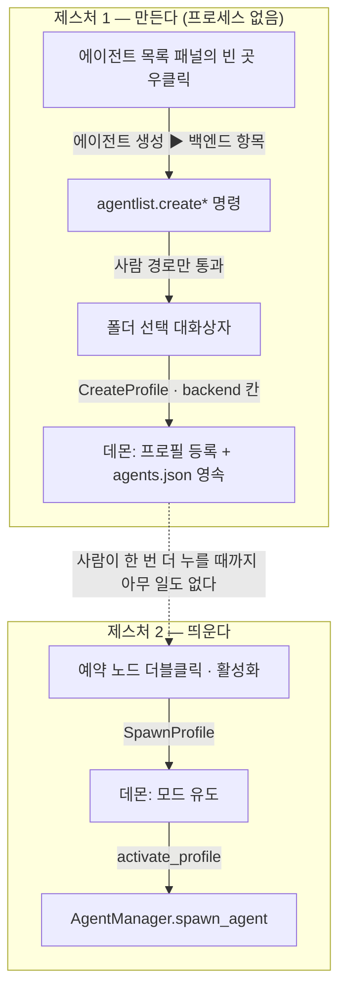
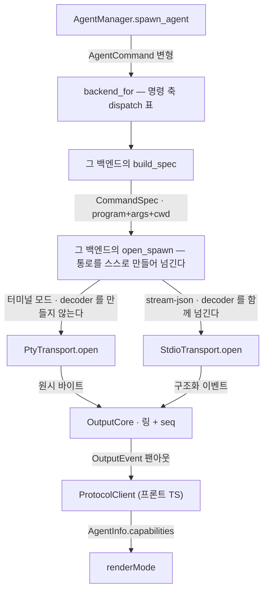
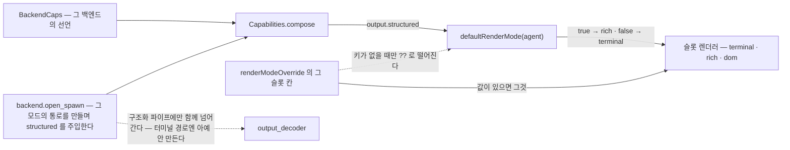
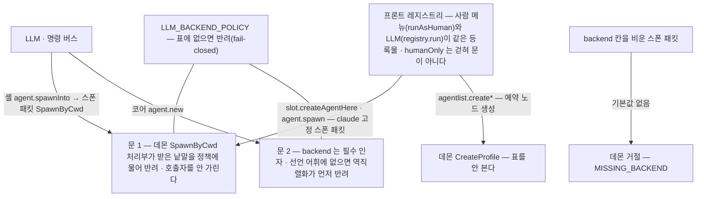

# Agent backend structure

> **This is a live explanation document.** Each time someone asks, the answer is written in here — it does not aim at a finished version, and tidying it properly is done when the user asks.
>
> **It is a reusable part.** Briefings · decks · TRDs **point to this and do not copy it** — if the same picture sits in two places, one of them quietly goes stale.
>
> **It is an evolving canon, so it is edited in place.** It is not a step snapshot — when the code moves, fix this file.
>
> **The subject is an extension axis, not a vendor.** A third backend adds **a column, not a file** — do not create a new file; add a column to the table in (B) below.
>
> **Baseline stamp:** branch `v0.3.0/feat/codex-backend` · code measured 2026-09-08 · scope = codex Phase 1 (up to launching).
>
> ★**Evidence anchors are written only down to file and symbol names**★ — line numbers go stale every time they are cited (proof: the 7 figures of TRD §2.5 went stale a day after landing).

**Whole picture** = `docs/reference/architecture.md`

---

# (A) The backend-neutral spine

There is one plumbing for launching an agent. Whether claude, codex or gemini, they **ride the same pipe**, and the only thing that differs per backend is what is pushed into the entrance of that pipe. So the four sections below **hold even without a backend name appearing** — when a new backend comes in, this section does not change by a single line, and only the table in (B) changes.

## Two gestures — creating and launching are separated

**Creating** an agent and actually **launching the program** are separated into two clicks. The first click only writes a 「예약」 (reserved) entry into the registry after choosing a folder, so at this point there is no process. Only when you double-click that reserved node shown in the tree or press 「활성화」 (activate) does the real CLI come up. The reason for separating them is that **choosing a folder and launching a program fail in different ways** — if they are glued together, then when the wrong folder is chosen, the process has to be cleaned up together with it.

The right-click spot is **an empty area of the agent list panel (the pane background)** and **not the row right-click menu.** If you right-click a row, the row menu wins and the parent slot menu does not appear at all (ADR-0064), so if you blur this distinction you cannot find the menu.

**Anchors** — `src/commands/agentCommands.ts` (`registerSlotMenu('agent_list', …)` · createReserved) · `src/components/agent/AgentList.tsx` (the bubbling rule in the file header · the `stopPropagation` of `onContextMenu` · activateReserved) · `crates/engram-dashboard-daemon/src/connection_core.rs` (CreateProfile · SpawnProfile handling)

## Spawn chain — until one CLI line reaches the slot

The code that knows 「어느 프로그램을 어떤 인자로 띄우나」 is confined to one folder per backend. Once that folder builds one command line and hands it over, nobody below it knows the backend — the transport only carries bytes, the core numbers those bytes and piles them into the ring, the daemon scatters them to subscribers, and the frontend receives and draws them. **The only places where a backend name is actually written are the registry and the two divergence tables.**

★**Do not write 「백엔드 전용 코드는 `build_spec` 안에서 끝난다」 — it is false**★. The same file also declares `assigns_session_id` · `can_resume_stored_session` · `supports_control_channel` · `accepts_mcp_config` · `writes_mcp_config_file` · `reads_messages` · `uses_mail` · `capabilities`, and depending on the backend even `transport_shape` · `output_decoder`. What ends is not that **function** but that **folder** (ADR-0004).

**Anchors** — `crates/engram-dashboard-agent/src/backend/mod.rs` (file header · backend_for · backend_for_encoder · the `open_spawn` default and `SpawnParts` · tripwire) · `crates/engram-dashboard-agent/src/backend/claude/mod.rs` (`open_spawn` — the only place where the real transport diverges) · `crates/engram-dashboard-agent/src/transport/pty.rs`

## Render branch (렌더 분기) — override first, then capability

What to draw in a slot is decided in two layers. **First** it checks whether the slot has a forced value (`renderModeOverride`) set by a person or an LLM, and **only when there is none** does it fall to the one capability field the agent reports. That field is 「출력이 구조화되어 있나」, and if structured it is the chat form (rich), otherwise the terminal (xterm). The renderer **never once looks at the backend name** — so even when a new backend comes in, the frontend does not change.

Two things are often got wrong. First, **there are three render modes** — `terminal|rich|dom`. If you write it as a dichotomy, dom disappears. Second, **the axis that leads to rich is not the decoder.** The output format (for claude, `--output-format stream-json`) picks the structuring and **the decoder is attached only to that branch** — that backend's `open_spawn` hands over the decoder together at exactly the place where it builds the structured pipe, and the terminal branch does not build one in the first place (since ADR-0191 **there is no discarded place at all**). 「decoder 를 선언하면 오른쪽으로 간다」 is a description with the causation reversed.

★**Do not cite ADR-0044 as the basis for the render-mode priority — it is false**★. That ADR is the decision on JSON-mode wiring and the new creation of `StdioTransport`, and the word `override` never appears in it (measured: 0 hits).

**Anchors** — canonical source of the priority = **ADR-0078** + the JSDoc of the `renderModeOverride` field in `src/store/viewStore.ts` · the real decision point = `SlotBody` in `src/components/layout/LayoutLeaf.tsx` (`renderModeOverride[node.id] ?? defaultRenderMode(agent)`) · mode vocabulary = `src/components/slot/renderMode.ts` (`RENDER_MODES`) · `src/api/types.ts`

## The closed door (닫힌 문) — one policy table, two doors that look at that table

There are several entrances for creating an agent, so if 「어느 백엔드를 만들 수 있나」 were written separately at each entrance, they would certainly drift apart. So **the policy is one table** (`LLM_BACKEND_POLICY`). A backend whose name is not in the table is not open but **blocked** (fail-closed) — the default is set toward preventing the accident of a new backend quietly opening without writing a policy.

There are **two** doors that look at that table — the daemon `SpawnByCwd` handler and the core `agent.new` (ADR-0279). ★**The daemon door does not distinguish the caller**★ — it does not know who sent the packet, so even though the table's name is 「LLM 제어 표면」 (LLM control surface), a claude-fixed spawn called by a person (`slot.createAgentHere` · the frontend `agent.spawn`) also looks at the same table (ADR-0279 「감수한 대가」 · impact today 0 — the table closes nothing). Conversely, **creating a reserved node from a human menu (`agentlist.create*` → daemon `CreateProfile`) and the agent bus `agent.spawn` (claude-fixed) do not look at the table.** In the frontend registry a human click and an LLM call are the same registered item, and the `humanOnly` gate that split the two along the caller axis was lifted on 2026-09-22 (ADR-0219) — it is not a door now.

A refusal message **always states both the reason and when it will be opened** — the code nailed it down that way (the doc of `LlmBackendPolicy.refusal`). It means that someone who meets that refusal half a year later must learn from one sentence what is being waited for. And 「모르는 낱말」 (an unknown word) and 「아는데 이 표면이 안 만든다」 (known, but this surface does not create it) are different axes, so they are not lumped into one message — if lumped, the caller sets out to fix a typo that is not even there.

**Anchors** — `crates/engram-dashboard-agent/src/commands.rs` (LLM_BACKEND_POLICY · llm_creation_refusal · NO_POLICY_DECLARED) · `src-tauri/src/layout/apply.rs` (parse_backend — the shell bears only the typo net) · `src/commands/registry.ts` (the `humanOnly` field doc · run vs runAsHuman) · `crates/engram-dashboard-daemon/src/connection_core.rs` (MISSING_BACKEND · by_cwd_refusal · llm_policy — policy wall = ADR-0279)

---

# (B) Per-backend fields

This is the only place where backends diverge. **A new backend is absorbed by adding one column to the table below, and (A) does not change.** gemini already has a folder and a stub standing, but it has no command variant and so is not wired into dispatch — which is why it is written together under the 「미배선」 (unwired) column.

## argv template

The command line that actually launches. The **order** of the arguments we attach and the `extra_args` the caller passed differs per backend, and that is not taste but a consequence tied to each CLI's argument grammar.

| Backend | Executable | Arguments we attach | `extra_args` position |
|---|---|---|---|
| `claude` (terminal) | `claude` — on Windows one layer of `cmd.exe /c` | `--session-id <sid>` (Fresh) / `--resume <sid>` (Resume) · if there is a control channel `--mcp-config <path>` · if there is a grant `--allowedTools <패턴>…` | consumed **before** our arguments — `--allowedTools` is variadic, so that group is placed at the very end |
| `claude` (stream-json) | same | `-p --input-format stream-json --output-format stream-json --verbose` + the session · MCP · grant arguments above | same |
| `codex` (terminal) | `codex` — the same one layer of `cmd.exe /c` | If Resume, the `resume <thread id>` subcommand at the **very front** (★not a flag★ — if pushed back, clap reads it as the root's `[PROMPT]`) · `--cd <폴더> -s workspace-write -a on-request` · if there is a control channel, **after** the passthrough, `-c mcp_servers.engram={…}` (the mail entrance) and `-c developer_instructions=…` (priming) | **after** our arguments, but **before** those `-c` overrides — if the same config key is passed twice with `-c` the last one wins (measured 0.155.0), so the mail entrance is loaded afterwards so that a single passthrough line cannot erase it |
| `codex` (app-server) | same | `app-server --stdio` + if there is a control channel `-c mcp_servers.engram={…}` — the working folder · sandbox · approval policy go not in argv but as `thread/start` parameters (`cwd` · `sandbox` · `approvalPolicy`). ★The lock polling of terminal mode is not in this mode★ — the transport receives the session id directly from the `thread/start` response (why terminal mode looks at the lock holder instead of that response = 「세션 id 회수」 (session id recovery) below) | same — ★but the two modes have different option sets, so an argument written by looking at the interactive CLI may be rejected here★ (not filtering per mode is a decision — the code comment is canonical) |
| `gemini` (unwired · 미배선) | `gemini` — ★best-guess, before the CLI spike★ | stub (the session flags are best-guess too) | undetermined |

The reason for wrapping one more layer on Windows is that the name on PATH is not the real executable but a `.cmd` shim — launching it directly dies with error 193. The reason we do not find the real path and call it is that the path is tied to the version and the CLI updates itself and moves it.

★**codex 「우리가 발급한 sid 를 넘기지 않는다」** (does not pass a sid we issued)★ — not 「argv 에 절대 안 실린다」 (is never loaded into argv). `extra_args` passes through as is, so if the caller puts it in, it gets loaded. What the dedicated test asserts is that, **on the basis of empty extras**, sid · `--session-id` · `--resume` · `--session` are not assembled. ★Do not read the `resume <thread id>` above as a counterexample to this sentence★ — what is loaded in that place is a value that **codex issued and we received and wrote down**, not a sid we drew (the reason the two values are different fields = the two session axes below).

★**Limit not fixed — `%VAR%` expansion**★ — `cmd.exe` expands `%NAME%` as an environment variable even inside quotes. If a word wrapped in `%` is actually in a folder name, the CLI receives **a different folder**. Fixing it means touching the assembly point shared with claude, and if wrong every spawn dies — the reason and the measurement needed are canonical in the code comment.

**Anchors** — `crates/engram-dashboard-agent/src/backend/claude/mod.rs` (CLAUDE_PROGRAM · build_spec) · `crates/engram-dashboard-agent/src/backend/codex/mod.rs` (CODEX_PROGRAM · CD_FLAG · SANDBOX_FLAG · APPROVAL_FLAG · RESUME_SUBCOMMAND · CONFIG_OVERRIDE_FLAG · `MCP_SERVER_OVERRIDE_PREFIX` · `mcp_attachment` (the only place that assembles the one value `-c mcp_servers.engram={…}` · result type `McpAttachment`) · `DEVELOPER_INSTRUCTIONS_KEY` · `backend/codex/thread_lock.rs` (lock-holder decision + polling) · the assembly-point `%VAR%` comment · argv unit tests) · `crates/engram-dashboard-agent/src/backend/gemini/mod.rs` (GEMINI_PROGRAM · best-guess comment) · `crates/engram-dashboard-platform/src/shell.rs` (console_command) · `crates/engram-dashboard-platform/src/file_holders.rs` (Restart Manager query) · `crates/engram-dashboard-platform/src/process.rs` (`subtree` — our process tree)

★**Do not use `mcp_server_override` as an anchor — there is no such symbol**★ (measured 2026-09-21 · 0 definitions in a whole-repository search). That name was written here and there was nothing for it to point at. The real thing is split into a prefix constant and an assembly function, so **the two names above are canonical.** ★The same name still lives in two rustdoc links of `backend/codex/mod.rs`★ — that is code, so it was not fixed here (broken intra-doc links).

## Session id recovery (세션 id 회수) (codex terminal mode)

codex issues the session id itself, and terminal mode has no response channel that tells it to us. So **we ask the OS** — codex runs **holding open** `$CODEX_HOME/thread-writer-locks/<thread id>.lock`, and we ask Windows Restart Manager **who is holding** that file and pick the one **inside our process tree**. The file name is the thread id. (ADR-0218)

★**What we compare against is not the one PID we hold but the whole tree rooted at that PID — if you shrink this to one slot, recovery never happens**★. A Windows spawn goes through one layer of `cmd.exe /c codex …`, so the PID the transport returns is **that wrapper**, and what holds the lock is the `codex.exe` below it. If you compare only the wrapper PID, a match never comes up, yet **there is no error and no log** — the thread runs empty-handed for the agent's whole lifetime (happened 2026-09-21). The tree is resolved again every round: the shim launches codex late and codex launches tools in turn, so if fixed in advance we cannot see a codex that came up late.

- **The decision requires both the PID and the process start time to match.** A PID is reused, so a PID-only match writes someone else's thread into our handle — that failure is silent and the next resume opens someone else's conversation.
- ★**A descendant cannot be born before its parent — discard what was born earlier**★. Without this a stranger enters our tree: a `codex.exe` launched by hand by the user becomes an orphan and remains with the recorded ppid `P` as it is, and if Windows reuses `P` for our wrapper, process enumeration returns that stranger as our child. That stranger's identity naturally matches its own lock's holder, so in the span **before our codex creates its lock** it becomes the only candidate and is adopted without even an ambiguity decision showing. (A child that appears on the same tick passes — what is blocked is only what was born earlier.)
  - ★**This rule is not 「전수」 (exhaustive) — three accepted residuals are nailed into the code (do not argue it again · decided 2026-09-21)**★. ① **PID reuse between the enumeration and the start-time read** — if the owner of the number the enumeration gave dies before we read and the number passes on, the start time we read is **the new owner's**. The enumeration and the lookup are separate syscalls so there is no means of fixing it atomically, and the window is on the microsecond scale. ② **The same tick (`==`)** — the one just let through above. ③ **Explicit parent assignment** — on Windows a process can be created with its parent nailed in via `PROC_THREAD_ATTRIBUTE_PARENT_PROCESS`, so a stranger born that way is born **after** our root and yet carries our root's PID as its ppid and passes this comparison. ★Even so, the rule's value stays as it is★ — the common path (the case where the number held by the process that spawned it is reused for our root after it dies) is closed entirely, and for ③ to become **an actual false detection**, that stranger must also be holding a `<uuid>.lock` under our `CODEX_HOME`. Canonical source = the `LockHolderProbe::our_processes` doc in `crates/engram-dashboard-agent/src/backend/codex/thread_lock.rs` (the OS fact of the three residuals itself is in the `subtree` doc in `crates/engram-dashboard-platform/src/process.rs`).
- **What we count is not lock files but 「맞은 홀더」 (matching holders).** If two of our processes hold one lock together, it is a state where whose lock it is has not yet been narrowed — counting only files lets that state pass as an adoption. The cost is that adoption is postponed while there is a child that inherited the handle, and since polling does not stop, we catch it on the next round once that child ends (whether handle inheritance actually happens is unmeasured).
  - ★**This line is a hold, not a closed decision — the code is written that way too**★. The counterargument = 「둘 다 **우리** 프로세스면 그 락은 우리 것이 맞으니 채택이 옳다」, and then the unit of counting goes back to the file. **To overturn it, first measure whether handle inheritance really exists and reopen ADR-0218 decision 3 on top of that measurement** — do not quietly swap it out here.
- **The file name accepts only the canonical uuid (36 characters with hyphens).** If we also accepted 32 characters without hyphens · braces · `urn:uuid:`, one file we did not create would increase the candidate count, flip the decision to ambiguous and stop recovery altogether. Case is not distinguished.
- **If there are two or more candidates, nothing is adopted this round — but it does not stop.** Whether one codex process holds two or more locks is unmeasured, so we refuse instead of guessing, but the overlap may be only temporary, so polling continues (if it ended there, one short overlap would end that agent's recovery for good).
- **It runs only on a fresh incarnation.** A take-over incarnation has already carried the id out in argv.
- **The waiting is polling, not a time window.** Only two things stop it — we caught it, or the child died. There is no upper-bound time. The decision is ownership, not time, so waiting long does not increase false detections. One round opens one Restart Manager session per candidate file, so the wait doubles from 0.5 seconds and stops growing at 15 seconds.
- **We do not read the file content** — it is 0 bytes, and starting to read would make us depend on the vendor's storage format (ADR-0203).
- **It is Windows only.** We provided no means of asking this question on other OSes, and the failure mode there is **「못 받음」** (not received), not a false detection.
- **The only write path is `SessionIdSink`** — the verb the assembly point passed bundled with the incarnation marker. If you build a second path that touches the profile directly, it bypasses that guard.
- **The `CODEX_INTERNAL_ORIGINATOR_OVERRIDE` marker is not used for recovery** — it remains only for diagnostics (ADR-0218 decision 8). There is no place that reads it and compares.

★**The guard when reusing the recovered value**★ — `codex resume <값>` **does not fail even when wrong**: given a string it cannot read as a thread id, it reinterprets it as a **session name**, quietly creates a new session, ends with exit code `0`, and the turn is billed (measured 2026-09-21). That is, the cost of a wrong value is not an 「오류」 (error) but 「사용자가 이어받았다고 믿는 새 대화」. So if the handle cannot be loaded, we do not emit the subcommand at all (it falls to the new-conversation argv, and the activation entrance reports that regression). ★Do not merge it with claude★ — claude's `--resume` fails honestly on an unknown value, so it does not need this guard, and if it were raised to the shared place, one backend's upstream bug would become everyone's assembly rule.

**Anchors** — `crates/engram-dashboard-agent/src/backend/codex/thread_lock.rs` · `crates/engram-dashboard-platform/src/file_holders.rs` (Restart Manager query) · `crates/engram-dashboard-platform/src/process.rs` (`subtree` — our process tree) · `crates/engram-dashboard-agent/src/backend/codex/mod.rs` (the terminal branch of `open_spawn` + the `terminal_capture_wiring` real-process wiring test)

## capability declaration

It is not that a feature is 「빠진」 (missing); **the backend reports for itself that it has none**, and the core locks the plumbing as reported. So the `false` cells of this table are generally the list of items to open in the next stage. ★But do not read every `false` as 「아직 안 연 것」 (not yet opened)★ — the `false` of `writes_mcp_config_file` is not unwired but **a decision not to write secrets to disk** (the last cell of that row is canonical). When a new variant is wired, the tripwires force this report with a compile error — because on an axis whose default is fail-open, omitting the declaration quietly turns green. ★The two session axes are not that kind★: the trait has no default, so a **new backend** has no choice but to write a value, and instead, since the compiler cannot see a **new output mode**, the per-mode tripwire (`backend::tests::expected_session_axes`) takes care of that side.

| Declaration | `claude` | `codex` | `gemini` (unwired · 미배선) | What the core locks with that value |
|---|---|---|---|---|
| `assigns_session_id` | `true` (both modes) | `false` (both modes) | `true` (best-guess stub) | Whether **we** draw the sid and pass it into the spec. If `true`, the manager issues it and **persists it at the first submit** (before that it is only in memory — the first-submit latch, ADR-0226) and also uses it as the watcher's reference value. Do not read `false` as 「세션이 없다」 (there is no session) — it may be that the program issues its own id itself |
| `can_resume_stored_session` | `true` (both modes) | `true` (both modes — only the **means** of taking over differs) | `true` (best-guess stub) | Whether **it can take over with the stored backend sid**. It does not ask who issued it. Boot restore and the activation entrance both decide with the single `backend::can_resume_profile` (this axis ∧ sid exists) — if `false`, Fresh even when a sid remains. ★One exception★: WS `SpawnProfile{resume:true}` **bypasses** that decision and goes to Resume (`resume \|\| can_resume_profile(…)`) |
| `reads_messages` | `true` (trait default) | `true` | `true` (trait default — not declared) | If `false`, **excluded from the mail recipient list**. The busy gate is fail-open, so a backend without a turn signal is always read as idle and a letter is inserted mid-thought — that cost was accepted explicitly by ADR-0116 decision 7 |
| `supports_control_channel` | `true` | `true` | `false` | If `true`, the manager calls provision before spawn (token + CLI entrance issuance). If `false`, it **does not touch provision at all**. ★Do not read it as this field calling even the mcp-config **file**★ — that write is separately decided by `writes_mcp_config_file` below |
| `accepts_mcp_config` | `true` (`--mcp-config <path>`) | `true` (`-c mcp_servers.engram={…}`) | `false` | Whether priming is **loaded** (to load or not — not a variant axis. The CLI edition was deleted in `2ef6902`) and the **mail-channel decision** diverge on this value (the daemon derives the single value `mail_allowed` together with `uses_mail`). ★Reading it by its name as 「우리 mcp-config **파일**을 먹나」 is wrong★ — what this field substantively asks today is 「이 스폰이 MCP 로 우편을 쓰나」, and the file axis is borne by the row below. The only enforcement is a daemon refusal |
| `writes_mcp_config_file` | `true` | `false` | `false` (trait default) | Whether the daemon **writes plaintext Bearer-token JSON to disk** for this spawn. If `true`, it writes the mcp-config file and the session-settings fragment, and a write failure of that file is **fail-closed** (the spawn is aborted) — because for that backend, without the file the MCP entrance physically disappears and it becomes an agent running with no control channel. If `false`, it makes neither and the two fields of the endpoint go out as `None`. ★Do not derive it from the field above★ — during the double-duty period, merely by turning on the field above to fit the mail axis, codex received **a plaintext token file that nobody opens** on every spawn, and that fail-closed **could abort a spawn because of a file that is never read**. The default `false` is opposite in direction to the two fail-open mail axes, because what is measured differs — the cost of a wrong `false` is a loud missing file and the cost of a wrong `true` is a quiet plaintext token |
| `output_decoder` | `Some` only for stream-json | `Some` only for app-server (`None` for terminal) | none (trait default `None`) | Presence of structured events → the branch of (A) 「렌더 분기」 (render branch) |
| `transport_shape` | stream-json → `StdioNdjson` · terminal → `Pty` | app-server → `StdioBidiJson` · terminal → `Pty` | `Pty` (trait default) | ★**It is only a reported value and does not choose the transport**★ — the real one is built by `open_spawn`, and this value is not read back inside it (ADR-0191). Today the only place that reads this value is the declaration-table tripwire (`tests::expected_codec_axis`), so even if the report and the real one drift apart no gate can see it |
| `capabilities().session.resume` | `true` | `true` (both modes) | `false` (conservative stub) | Whether lossless restore is possible. ★Turn it on **with the same predicate as** `can_resume_stored_session` above★ — if they diverge, a spawn that does not take over is reported as taking over, or the reverse |

★**Do not fold the two MCP fields into one — that double duty was a real defect**★. Unlike its name, `accepts_mcp_config` today means **「이 스폰이 MCP 로 우편을 쓰나」** (the daemon derives whether mail is allowed from it), and the only one that asks **「우리가 디스크에 평문 Bearer 토큰 JSON 을 쓸까」** is `writes_mcp_config_file`. codex is the real case where those two diverge — MCP attaches (the single value `-c mcp_servers.engram={…}` alone · the token goes not in argv but as **the name of the env variable holding that token**) but there is no flag to point at the **file** we wrote (measured 0.155.0 — there is no `--mcp-config`, no `--settings`, and no `--config <파일>` pointing at a config file). During the double-duty period, merely by turning on the earlier field to fit the mail axis, codex received a plaintext token file nobody opens on every spawn, and since that write was fail-closed, **a spawn could be aborted because of a file that is never read**.

★**So if you meet a place written as 「codex 는 MCP 가 아직 배선되지 않았다」 or 「codex 는 우편 평면 밖이다」, it is stale**★ — the wiring stands and only the mechanism differs from claude, and receiving (`reads_messages`) and sending (`uses_mail`) are **both** on. Only when those two stand together is the 「받기 먼저」 order kept — if only one side is reverted, the asymmetry where only sending is open comes back (ADR-0209 decision 4).

★**Do not read the session axes as 「발급 주체 = 복원 가능 여부」**★ — that equation was discarded by ADR-0185, and the two rows above being split is the real form of that discarding. The invariant now is **「복원은 프로필에 저장된 backend sid 단독에 의존하고, 발급 주체는 백엔드가 정한다」**. codex is the counterexample to that equation — codex does the issuing (`assigns_session_id: false`) while we open the take-over. Of the three Phase 2 requirements of ADR-0185 decision 2 (role separation · activation-entrance guard · receiving wiring), **even `thread/resume` has landed**: `open_spawn` receives 「이어받을 저장된 sid」 from the assembly point, and if there is one the transport emits `thread/resume` instead of `thread/start`. ★**If you meet a place written as 「남은 것은 `thread/resume` 하나다」 or 「수령 배선이 없다」, it is stale**★. Canonical source for the axis invariant and the state mapping = `docs/reference/architecture.md` 「세션 복원 · 활성화」.

★**codex's two session fields now do not distinguish the mode — what differs is the 「수단」 (means) of taking over**★. The reading that used to be here was 「터미널 모드에는 이어받을 식별자 자체가 없다」, but it was **wrong**: that mode takes over with the `codex resume <thread id>` **subcommand** (not a flag), and that handle is recovered from **the file name of the writer lock held by that child** and written into the profile (ADR-0218 — 「세션 id 회수」 above. That place was once taken by a `SessionStart` hook (ADR-0208) and after that by TUI status-line scraping (ADR-0216), and both were removed from the repository). The app-server mode emits `thread/resume` with the same value. ★**If you meet a place where terminal mode is written as `false`, it is stale**★. Those two fields in the declaration table (`tests/backend_contract.rs`) are still in the per-transport tuple shape, but **today both sides have the same value** — not reverting the shape is a place kept for the day they diverge, not a sign that they diverge now.

**What actually diverges in this row is not the transport but two axes** — codex does the issuing (`assigns_session_id: false`) and we open the take-over (`can_resume_stored_session: true`). ★Do not turn on only one of the two fields, or only one of the two modes★ — a new thread would be reported as 「이어받음」 or the reverse.

★**A rejected take-over does not fall back to a new thread (ADR-0082)**★ — the session simply ends and the profile's handle is preserved. One addendum reason on the codex side: the `-32600` of this protocol does not mean one thing — an unknown method · a duplicate `initialize` · a config error all arrive with that code (measured 0.154.0 — the canonical source is `backend/codex/protocol.rs` and its transport test bench). If you split off 「모르는 스레드」 by that code and fall back, you overwrite a still-healthy handle on an unrelated failure.

A similar misreading exists in the model-selection field. codex has `-m` and yet it is `false`, because this field reports **what this spawn actually uses**, not **what that program can do**.

★**The prediction that was here was proven wrong by measurement — do not revive it**★. That sentence was 「codex 의 상주 JSON-RPC(`codex app-server`)가 서면 이 표의 여러 칸이 한꺼번에 열린다 — 턴을 관측할 수 있게 되는 순간 세션 복원·턴 관측·구조화 챗이 같은 문으로 들어온다」. **All three axes are now open. But only one of them came in through that door** — `output_decoder` (structured chat = turn observation). The other two were opened by **different wiring** each, and that is the point where this prediction was wrong.

- **Session restore — opened, but not 「한 문」 (one door).** The four requirements of ADR-0185 decision 2 landed **separately across three commits** (role separation · activation-entrance guard → receiving wiring → `thread/resume`), and after that **terminal mode was opened separately by a path unrelated to the resident server** — we recover separately the id that `codex resume <id>` will use (today that recovery is the lock holder — ADR-0218 · 「세션 id 회수」 above. That place was taken in turn by a hook and by status-line scraping and then removed — ADR-0208 · 0216). The fact this item leaves is that each stage passed **leaving the previous stage's value deliberately as it was**: if you turn on the field before the wiring, a new thread is reported as 「이어받음」.
- **Mail — opened, but not by the resident server.** ★**If you meet a place written as 「`reads_messages` 는 여전히 `false` 다」, it is stale**★ — receiving and sending (`uses_mail`) are both `true`. The reason it opened is not that a turn signal appeared but that **the premise 「관측할 수 없으니 배달할 수 없다」 was rejected** (ADR-0116 decision 7 — if there is no turn signal, inject immediately without a gate. That CLI's own input queue is the gate, so we have no reason to observe idle). The ground for that rejection is that **terminal claude, with zero signal, was already receiving in exactly the same place**, and so even the codex terminal mode, which has no decoder, was opened with it. The cost (an envelope can be inserted in the middle of a turn and a TUI modal widget can swallow it) was accepted explicitly by that decision. ★The old description's 「여는 조건 = 이 축을 모드별로 가르는 것」 is dead★ — it was opened without splitting.

★**So do not set up 「뿌리가 같으니 문도 하나」 again**★. Reading the three axes as sharing the root of a resident stream was already overreaching — what actually required that root was only structured chat, and the other two each required **their own wiring** separately (hook recovery · a delivery-policy decision). This prediction lumped the three together once and was wrong — we write it down as failed so as not to derive the same optimism again.

**Anchors** — `crates/engram-dashboard-agent/src/backend/mod.rs` (the defaults of the `AgentBackend` trait · tripwires `tests::expected_channel_matrix` · `tests::expected_session_axes`) · each `backend/<이름>/mod.rs` (that backend's declarations and reason comments) · `crates/engram-dashboard-agent/src/types.rs` (`ControlChannelNeeds` — the shape in which the three fields cross over to the daemon) · `crates/engram-dashboard-daemon/src/control/mod.rs` (`DaemonControlChannel::provision` — the only place that derives `mail_allowed` · `wants_priming` · the mcp-config write) · `crates/engram-dashboard-agent/tests/backend_contract.rs` (the real declaration table)

## LLM endpoint policy

「LLM 이 이 백엔드를 만들 수 있나」 is closed differently at each entrance. The difference matters because, when trying to open some door, **what has to be touched differs per door.**

| Endpoint | Where | `claude` | `codex` | `gemini` (unwired · 미배선) |
|---|---|---|---|---|
| Human menu — the three claude-family items (`agentlist.createAgent` · `createTerminal` · `createJson`) | `src/commands/agentCommands.ts` | creates — claude is hard-coded in the code through `createReservedProfile` → `createClaudeProfile` | **cannot choose** (there is no field that accepts that word) | no item |
| Human menu — the two codex items (`agentlist.createCodex` · `createCodexJson` — interactive TUI / resident JSON server) | same | — | creates (the LLM too, via `registry.run` — row below) | no item |
| LLM · frontend registry (`registry.run`) | `src/commands/registry.ts` | the three above pass as they are | passes — `humanOnly` was lifted on 2026-09-22 (ADR-0219) | — |
| LLM · shell `agent.spawnInto` | `src-tauri/src/layout/apply.rs` → daemon `connection_core.rs` | passes | passes — the shell **accepts** the word, passes it only through the typo net (`parse_backend`), loads it into the spawn packet, and the daemon `SpawnByCwd` handler asks the policy and opens it (ADR-0279) | the word is not in the wire enum, so `parse_backend` refuses first |
| LLM · core `agent.new` | `crates/engram-dashboard-agent/src/commands.rs` | passes — `backend` is a **required argument** (refused if unspecified) | passes — the declared vocabulary `AgentBackend` has `Codex` and the policy is also open | same |
| LLM · `agent.spawn` (immediate cwd spawn) | `src/commands/agentCommands.ts` | `'claude'` is hard-coded in the code | **cannot choose** | **cannot choose** |

★**「못 고른다」 (cannot choose) and 「골라도 정책이 닫는다」 (the policy closes it even if chosen) are different axes**★ — if blurred, what has to be touched when opening some door disappears. `agent.spawnInto` is the side that accepts the word and has the policy decide (today it opens it), and `agent.spawn` is the side that has no field that accepts the word at all.

★**codex was opened on the LLM surface too on 2026-09-22 (ADR-0219)**★ — ~~codex raises its own trust-confirmation modal in a folder it sees for the first time, and a non-human caller cannot get past that modal. Opening time = Phase 2~~ is a description that died that day. In measurement (codex-cli 0.155.1) the `app-server` transport returned success for `thread/start` on **a folder never seen before** in about 338 ms (no error · no inbound trust request) and wrote that folder into its own `config.toml` as `trust_level = "trusted"` by itself. **The folder-trust modal was a TUI-only device**, and in that mode the modal shows on the screen and a person answers. The canonical source for the reason and the opening time is still the code (`commands::LLM_BACKEND_POLICY`) and for the reversal it is ADR-0219.

**Today this policy table closes no word.** So neither the policy arm of `agent.new` nor the policy arm of the daemon `SpawnByCwd` handler fires — only the **reason** it is not reached differs (before, the declared vocabulary was narrower than the table; now the vocabulary and the table open the same set and the table closes nothing). ★Even so, do not delete it★ — the edit that arm blocks is 「어휘를 넓히면서 정책 표는 안 넓히는 것」, and the day that combination arrives it becomes the only runtime defense. The table itself remains too: 「선언 없음 = 닫힘」 (`NO_POLICY_DECLARED`) takes in the next backend fail-closed.

**Anchors** — same as the anchors of (A) 「닫힌 문」 (the closed door) + `src/commands/agentCommands.ts` (the hard-coding comment of `agent.spawn`). ★The `CODEX_HUMAN_ONLY` anchor that was once here is deleted — that constant was removed on 2026-09-22 (do not search by that name).★

## wire variants

If you add one backend, the word has to stand in **four places** each. The core's execution-command variant, the wire word that flows over the socket, the declared vocabulary of the LLM entrance, and the dispatch wiring. If you widen only one of the four, the rest stay not knowing that word.

| Axis | `claude` | `codex` | `gemini` (unwired · 미배선) |
|---|---|---|---|
| Core `AgentCommand` variant — being `#[serde(tag = "kind")]` it sits in `agents.json` as is | `Claude { extra_args, output_format }` | `Codex { extra_args, output_format }` | none (variant not created) |
| wire `AgentSpawnCommand` variant — the mirror of the variant above (the registry that flows over the socket has this shape) | `Claude { extra_args, output_format }` | `Codex { extra_args, output_format }` | none |
| wire `AgentBackendKind` word — `rename_all = "lowercase"` | `claude` | `codex` | none |
| Declared vocabulary `AgentBackend` (the `agent.new` entrance) | `Claude` | `Codex` (2026-09-22 · ADR-0219) | none |
| Dispatch wiring (`backend_for`) | present | present | **absent** — there is no variant so it is not routed to this backend (a stub for securing structure) |

**`PROTOCOL_VERSION = 6`.** The 6 was raised after this work by the pending-input list command (ADR-0231 — reason = the v6 entry in `crates/engram-dashboard-protocol/src/lib.rs`). This work raised it twice, to 4 and 5, and **the reasons differ from each other**. 4 = the spawn command is an enum split by a `kind` tag, so adding a variant is a hard break — an unknown variant is not ignored but becomes a deserialization failure. 5 = the codex output mode is an axis that crosses the wire, but this one **does not break the shape** (the new field is `#[serde(default)]`, so both sides parse alive). ★So 「모양이 깨질 때만 올린다」 is not the criterion★ — the criterion for raising is **a silent malfunction**, and an old daemon that drops that value passes the handshake while launching the interactive TUI behind the 「코덱스 JSON」 label. The daemon outliving a shell rebuild is by design, so 「릴리스 상대가 없다」 does not prevent either failure. Canonical source for the per-version reasons = the doc of that constant.

★**A version mismatch with a live daemon is refused by discovery — it is not a silent malfunction**★. If the `protocol_version` in `daemon.json` differs from this client and the recorded pid is **alive**, the decision does not overwrite that daemon with a spawn but fails with `DiscoveryError::VersionMismatch { daemon, expected }`. If the pid is already dead, that record is stale regardless of version and is not a target for refusal — a new daemon is launched. What the decision looks at is only same or different, so it does not ask which side is newer. **The value of the two bumps is here — 「분명한 거부」 (a clear refusal).** If we had not raised it, this would be the place where two builds passed the handshake and read different words · different modes as the same.

The parse-failure story is **after that**, on the disk axis. The profile file is parsed whole in one go, so if there is even one unknown `kind`, not that one entry but **the whole parse fails** (corruption) and it **boots with an empty registry**, then just before the first save copies that file to the fixed name `agents.json.corrupt` and overwrites it (the next corruption overwrites that copy — ADR-0291 R9 · the old 「`.corrupt-<ms>` 로 밀어낸다」 was lifted on 2026-10-10 (boundary refactoring A U5a)) — one agent launched with a new backend disappears together with all the rest. ★But if that build raised `schema_version`, the old build neither reads nor overwrites that file and comes up read-only for that whole run (ADR-0291 R2) — if the edition was not raised, the loss above is as it stands★. So widening the vocabulary is not 「변형 하나 더」 but a migration that breaks disk compatibility. This backward compatibility was accepted because it is under development, and the re-introduction trigger is hung in the tracking table as 「그 `kind` 가 실린 빌드가 릴리스로 나가는 순간」 (`docs/tracking.md` T-33 — the three options at that time are there too).

Two more things are nailed in as decisions. **The backend field is required** — the daemon refuses an empty field and the daemon even produces the wording that says which field to fill in. Because if there were a quiet default like 「안 적으면 claude」, **not having chosen and having chosen claude could not be told apart**. And **`claude_session_id` → `backend_session_id` is a hard rename with no shim** (disk · wire · API at once) — meant so that the name no longer says 「누가 id 를 발급하나」, with claude receiving ours and codex making its own and telling us.

**Anchors** — `crates/engram-dashboard-protocol/src/domain.rs` (AgentBackendKind · absence = error comment) · `crates/engram-dashboard-protocol/src/messages.rs` · `crates/engram-dashboard-protocol/src/lib.rs` (PROTOCOL_VERSION · changelog) · `crates/engram-dashboard-agent/src/profile.rs` (AgentCommand · `serde(tag = "kind")`) · `src-tauri/src/discovery/mod.rs` (check_acceptable · DiscoveryError::VersionMismatch) · `crates/engram-dashboard-agent/src/persistence/mod.rs` (FileProfileStore::load) · `docs/tracking.md` T-33

---

## What is untested (무엇이 미검인가)

**Limits attached to the structure.** A folder path containing `%VAR%` still leaks to a different folder, and the known fix is not a general escape but is in a not-yet-ported state. There is **no unknown-`kind` regression test** that would catch the disk backward compatibility above. And **a real model turn has not been measured** — the standing lane of the contract test bench is only the declaration-table comparison, and the lane that launches a real CLI is `#[ignore]`, so it runs only when called.

**Record debt.** The five big decisions of this work **have no ADR** — the `PROTOCOL_VERSION` 4 bump · the **5 bump** (user decision 2026-09-13) · the new wire enum · the `backend_session_id` hard rename · the 「사람만」 exception (`humanOnly`). The **conclusion of the CI** that was pushed was also not confirmed, and it was **not registered in the step-log either.**

## Where it came from

- **Design grounds · rejected alternatives** = `docs/process/S21-codex-backend/trd.md` — ★the figures in its §2.5 are a **2026-09-07 reading snapshot**, so the line numbers are stale★.
- **Landing briefing** = `docs/process/S21-codex-backend/briefing.html`
- **Picture-first reading surface** = `agent-backend.html` (this folder) — a presentation that shows the same structure first as mermaid figures. ★**It is not a 「그 당시 문서」 — it really is rewritten**★ (most recent = 2026-09-14, commit `f9749b3`). ★**Do not revive the old sentence 「그 페이지는 구조가 바뀔 때마다 갱신하지 않는다」**★ — while it was alive, we ended up in a state where **the two files pointed at each other as 「낡은 쪽」** (that side was writing this file as canonical).
  - **The dividing line is not 「최신 대 구본」 but 「무엇을 싣나」.** The figures · the skeleton · the at-a-glance comparison are better there, and **the detail a slide cannot carry lives only in this file** — the argv template · the wire variant axes · the disk backward compatibility · 「무엇이 미검인가」. So **when the detail drifts field by field, this file is canonical.**
  - ★**We do not write here a promise to always fix the two side by side**★ — there is no gate on either side to enforce it. If you write a promise that cannot be kept, the next session reads the side that does not match as the correct one.
